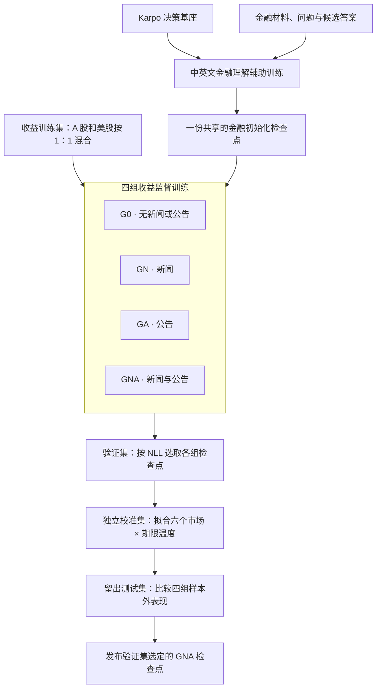
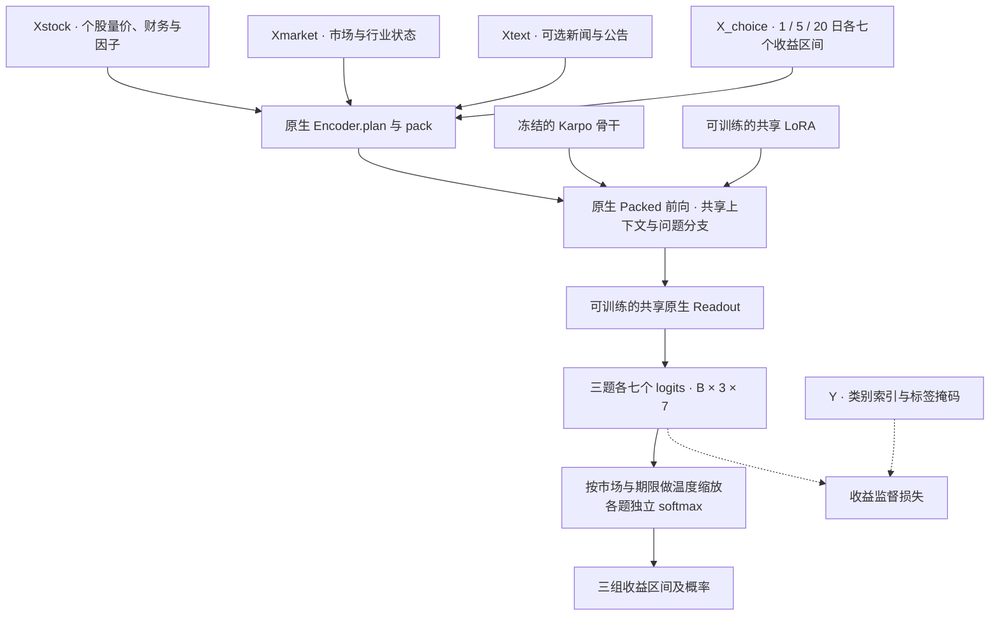

<h1 align="center">Kurumi</h1>

<p align="center">
  
</p>

## 项目简介

作为个人研究项目，研究在结构化金融数据相同的条件下，收益预测后训练中加入新闻、公告或两者，是否改善样本外预测准确率和概率质量。实验在统一的推理环境中比较四组模型，以测试结果判断文本是否带来增量价值。

作为创新实践项目，预计基于当前SOTA级别的决策模型，对其进行金融领域的后训练，使其可以实现给定股票、决策时点和预测期限，它综合行情、财务与新闻公告等多源信息，直接输出未来收益的方向、幅度区间和对应概率，把大模型从自然语言的幻觉推进为能实际做出有价值的决策。

项目计划基于 `MachinePulseAI/karpo-decision-31B` 后训练一个 A 股与美股共用的决策模型。模型预测个股未来 **1、5、20 个交易日**的收益分布，每个期限输出七档收益区间、各档概率及实际收益率边界，可分别汇总下跌、零收益和上涨的概率。

## 后训练路径



| 阶段 | 训练或评价方式 |
| --- | --- |
| 金融理解 | 用中英文金融材料构造原生决策任务。以单位和财务口径、数值推理、公告证据、事件状态等问题做交叉熵监督，得到四组共用的一份初始化检查点。 |
| 收益监督 | A 股与美股在有效批次中等权，1、5、20 日任务等权。各期限只在有效标签上计算 `交叉熵 + 0.5 × Brier + 0.5 × 归一化 RPS`，其中 RPS 利用收益档位的顺序。 |
| 验证选点 | 对两个市场、三个期限的 NLL（负对数似然）取等权平均，以最小验证 NLL 选取检查点。 |
| 概率校准 | 冻结模型，在独立校准集上为每个市场 × 期限组合拟合一个温度，保存缩放前后的概率。 |
| 样本外测试 | 按训练组、市场和期限报告 NLL、Brier、RPS、七档准确率和校准表现。测试集用于最终评价，发布版本由验证集选出。 |

G0、GN、GA、GNA 只改变**收益监督阶段**能看到的新闻和公告。四组共享数值输入、样本清单、标签、时间切分、采样顺序和更新预算，并使用种子 17、29、43，共安排 12 次收益监督训练。

主评估统一向四组提供新闻与公告，以衡量完整输入环境中的文本后训练效果。G0 和 GNA 再以无文本输入计算未校准概率，形成两种训练条件与两种推理条件的对照。 [后训练规划与实验设计](docs/kurumi_post_training_plan.md)

## 预计决策模型架构



- **一个模型覆盖两个市场。** A 股和美股共享骨干、LoRA 和原生 Readout。LoRA 挂载于注意力与 MLP 的线性投影，原始骨干权重保持冻结。
- **三个问题共享输入。** 原生编码器负责问题布局、选项编码与读出位置。Readout 按 `return_1d`、`return_5d`、`return_20d` 顺序取分数。每个期限单独归一化，再按需汇总上涨、下跌和零收益概率。
- **训练与推理复用输入契约。** 训练从温度缩放前的 logits 计算损失，标签只进入监督分支。数值装载、原生编码与可微的 Packed/Readout 接口已有实现，完整训练与发布仍在规划中。 [数值加载器](src/kurumi/numeric_loader.py) · [Karpo 数值适配](src/kurumi/karpo_numeric.py)

## 数据契约

### 样本、时点与输入

样本粒度为**稳定证券身份 × 本地交易日**，覆盖沪深北 A 股普通股，并按同一口径接入美国主上市普通股。证券身份、行业归属和上市状态沿用历史版本，包含符合条件的已退市证券在历史上市期间的记录。

预测截止为目标市场本地交易日 `23:59:59`，另存 UTC 时点。原始记录保存报告期、生效区间、公开时间、可得时间、来源和版本。先按 `available_at <= asof_utc` 过滤，再选取当时适用的版本。只有公告日期时，从来源地的次日零时起使用。财务按当时可见的正式合并报表选锚点，再计算单季、近四季合计（TTM）和同比，修订从公开时点起生效。

| 对象 | 内容与约束 |
| --- | --- |
| `Xstock` | 个股身份与交易状态、最近 60 个交易日的量价序列、财务快照和 30 个核心因子。有效输入要求连续 61 个本市场交易日的有效实际收盘和复权因子，以及正的历史波动尺度。 |
| `Xmarket` | 市场与行业趋势、波动、广度、活跃度和覆盖信息。聚合要求有效成员至少覆盖历史母集前期市值的 99%。 |
| `Xtext` | 预留新闻、公告原文、来源、公开时间和实体索引。数值包用 `not_built` 标记文本接口状态。正式接入后，各组继续共用同一套数值字段与窗口。 |
| `X_choice` | 固定三个期限及各自的七个有序选项，含历史尺度、精确收益边界与端点闭合规则。 |
| `Y` | 收益、标准化收益、类别、目标日、可得时间、有效性及缺失原因，只用于监督和评价。 |
| `audit` | 样本 ID、数据版本、切分、来源和排除原因，用于审计和复现。 |

### 收益、分档与标签

设 `A_t` 为本币复权收盘价，`h` 为目标交易所的后续第 1、5 或 20 个交易日。历史尺度 `s_h = sigma_60d × sqrt(h)`，其中 `sigma_60d` 为截至样本日的 60 个日对数收益的样本标准差。监督使用目标日对数收益 `L = log(A_(t+h) / A_t)`，简单收益为 `expm1(L)`，标准化收益为 `Z = L / s_h`。切点 `c` 对应的实际简单收益边界为 `expm1(c × s_h)`。

| 类别索引 | Z 范围 | 含义 |
| ---: | --- | --- |
| 0 | `Z < −1.5` | 较大下跌 |
| 1 | `−1.5 ≤ Z < −0.5` | 中等下跌 |
| 2 | `−0.5 ≤ Z < 0` | 小幅下跌 |
| 3 | `Z = 0` | 零收益 |
| 4 | `0 < Z ≤ 0.5` | 小幅上涨 |
| 5 | `0.5 < Z ≤ 1.5` | 中等上涨 |
| 6 | `Z > 1.5` | 较大上涨 |

零档为单点，计算时仅用 `1e-12` 容差消除浮点误差。目标日由交易所日历定位。目标停牌无成交、退市后无报价、缺价或结果跨阶段边界时，屏蔽对应期限的监督。模型仍接收完整的三道问题，选项使用预测截止时已知的历史尺度计算。

### 时间切分

| 切分 | 本地预测交易日期 | 用途 |
| --- | --- | --- |
| `train` | 首个合格样本日至 2023-12-31 | 参数学习 |
| `validation` | 2024-01-01 至 2024-06-30 | 配置与检查点选择 |
| `calibration` | 2024-07-01 至 2024-12-31 | 拟合六个温度 |
| `test` | 2025-01-01 至 2026-06-30 | 最终样本外评价 |

各期限标签须在所属阶段的结果观察截止前可得。2026 年 7 月仅用于观察测试期末样本的未来收益。基座可能记忆历史结果的风险单独登记。

### Parquet 表、接口与验收

| 核心表 | 主键或粒度 | 内容 |
| --- | --- | --- |
| `stock_daily` | 证券 × 交易日 | 量价、股本、市值、公司行动、因子和质量标记 |
| `stock_fundamental_asof` | 财务快照 ID | 发行人的时点财务、TTM 组成项与来源 |
| `market_daily` | 市场 × 交易日 | 市场聚合状态及覆盖 |
| `industry_daily` | 市场 × 分类体系和版本 × 行业 × 交易日 | 行业聚合状态及覆盖 |
| `samples` | `sample_id` | 时点、历史窗口、尺度、快照引用、切分和文本占位 |
| `labels` | `sample_id` × 期限 | 目标日、收益、档位、有效性和来源 |

发布包以 `manifest.json` 关联分片、字段定义与规则版本。加载器按样本清单组装 `model_input`、`supervision` 和 `audit`。任何有效期限可提供监督，类别和掩码的逻辑形状均为 `[B, 3]`。

验收检查时点一致性、历史窗口、目标日及分档复算、切分、版本追溯和覆盖，并验证改变预测截止后的记录时，历史输入与原生编码保持一致。正式训练入口要求 `NUMERIC_READY`。当前沪深北 A 股数值包状态为 **`INCOMPLETE`**，主要缺口涉及历史股本、财务和行业覆盖，可显式用于质检。美股和新闻公告待接入。 [完整数据契约](docs/kurumi_numeric_dataset_contract.md) · [A 股数据报告](docs/cn_numeric_dataset_report.md) · [构建与验收记录](docs/cn_numeric_execution.md)

## 未来规划与开源发布

1. 补齐 A 股数值数据覆盖，按同一契约接入美股，落实新闻和公告的历史可得时间与选材规则。
2. 验证原生训练链路，完成四组收益监督实验、概率校准和样本外比较，记录数据版本、基座版本与运行配置。
3. **GitHub** 开源训练和评估代码、数据契约、实验配置及复现说明。**Hugging Face** 发布验证集选定的 GNA 模型包，包含 LoRA 权重、更新后的原生 Readout、精确基座版本、输入输出配置、校准参数和模型卡。受来源许可限制的原始数据通过获取说明和配置引用。

## 本地开发与资料

项目使用 Python 3.11 或 3.12。运行测试可安装 `dev` extra。源数据盘点还需 `quant` extra 和本地 `quant` 源码，路径通过配置指定，外部源码和原始数据按只读方式使用。 [路径配置示例](configs/paths.example.toml)

```powershell
python -m venv .venv
.\.venv\Scripts\python.exe -m pip install -e '.[quant,dev]'
.\.venv\Scripts\python.exe -m pytest -q
```

源数据盘点流程需要配置外部数据路径，全量扫描的耗时和临时磁盘占用取决于数据规模。

```powershell
Copy-Item configs/paths.example.toml configs/paths.local.toml
.\.venv\Scripts\python.exe scripts/inventory.py --config configs/paths.local.toml
.\.venv\Scripts\python.exe scripts/supplement.py --config configs/paths.local.toml
.\.venv\Scripts\python.exe scripts/auxiliary_tables.py --config configs/paths.local.toml
.\.venv\Scripts\python.exe scripts/schema_consistency.py
.\.venv\Scripts\python.exe scripts/relationship_details.py
.\.venv\Scripts\python.exe scripts/render_report.py
.\.venv\Scripts\python.exe scripts/verify_inventory.py
```

- [源数据盘点报告](docs/data_report.md) · [字段字典](docs/field_dictionary.md) · [盘点清单](docs/inventory/)
- [金融后训练研究参考](docs/research_references.md) · [本地参考资料索引](docs/references/README.md)
