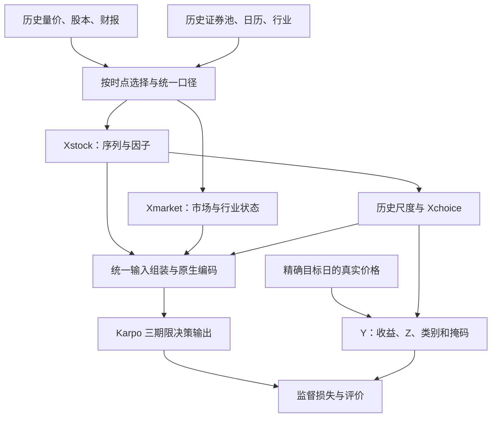

# Kurumi 后训练数值数据契约

- **版本**：1.2
- **日期**：2026-11-25（Asia/Shanghai）
- **状态**：执行定稿；作为数据构建、来源适配、训练接入与验收的共同依据
- **项目**：[sjyinzju/Kurumi](https://github.com/sjyinzju/Kurumi)
- **建议仓库位置**：`docs/kurumi_numeric_dataset_contract.md`
- **配套文档**：`docs/kurumi_post_training_plan.md`
- **范围**：Xstock、Xmarket、Xchoice、Y、数值输入接口和文本预留接口

本契约确定如何把原始金融数据转成可直接用于 Karpo 后训练的数值数据集。先建设 A 股，再按同一契约接入美股，两个市场共同训练一个模型。Xtext 的来源、内容选择和文本长度规则另行制定，既有数值样本、标签和时间划分继续复用。

文中的“必须”“不得”和公式属于执行要求。原始数据和模型尚未因本文件生成；数据是否就绪由第 13 节的验收结果决定。

## 1. 固定任务与数据对象

### 1.1 固定参数

| 项目 | 固定值 |
|---|---|
| 基座 | `MachinePulseAI/karpo-decision-31B` |
| 模型结构 | 保留原生决策结构；使用既定共享 LoRA 和原生 Readout |
| 市场 | `CN`：沪、深、北 A 股；`US`：美国主上市普通股 |
| 样本单位 | 稳定证券身份 × 本地交易日 |
| 预测时点 | 本地交易日 23:59:59 |
| 时区 | CN：`Asia/Shanghai`；US：`America/New_York` |
| 预测期限 | `[1, 5, 20]` 个目标交易所交易日 |
| 个股历史窗口 | 60 个逐日收益，需要连续 61 个交易日的有效实际收盘 |
| 模型量价序列 | 最近 60 个交易日，按时间升序 |
| 历史标准差 | 日对数收益样本标准差，`ddof=1`，不年化 |
| 收益口径 | 本币计价的供应商复权收盘至收盘收益 |
| 决策空间 | 每个期限七档；三个期限分别归一化 |
| 分档参数 | `[-1.5, -0.5, 0, 0.5, 1.5]`，零收益单独成档 |
| 核心个股因子 | 第 6 节规定的 30 个因子 |
| 测试样本终点 | `2026-06-30` |
| 标签观察终点 | `2026-07-31` |
| 市场／行业聚合门槛 | 加权收益要求至少 95% 证券数覆盖和 95% 已知前期市值覆盖；行业另有成员数和权重集中度检查 |
| 存储 | Parquet；历史母表共享，样本按需组装 |
| 正式收益训练 | 两市场有效批次权重 50%／50%；三个期限按训练规划处理 |

收益不包含手续费、冲击成本、融资成本或汇率投资收益。该任务预测已定义的价格结果；不在本数据集中生成交易执行收益或强化学习奖励。

### 1.2 输入、监督和审计分离

$$
X_{\mathrm{state}}=(X_{\mathrm{stock}},X_{\mathrm{market}},X_{\mathrm{text}})
$$

一条逻辑样本由下列对象组成：

| 对象 | 内容 | 用途 |
|---|---|---|
| `Xstock` | 个股身份和当前状态、60 日序列、财务状态、30 个因子 | 模型输入 |
| `Xmarket` | 所属市场与行业的状态、有效覆盖信息 | 模型输入 |
| `Xtext` | 本轮保留引用与建设状态 | 后续接入文本 |
| `Xchoice` | 三个期限、各自尺度、七个有序收益区间 | 模型输入 |
| `Y` | 真实未来收益、Z、类别、标签有效性 | 损失与评价 |
| `audit` | 数据版本、来源、split、排除原因、计算记录 | 审计，不进入模型 |

真实未来 R、Z 和标签有效性不属于 Xstate。三个期限共享一份数值上下文；即使某期限没有有效监督，输入仍保留全部三个问题。



## 2. 样本范围、时间划分与边界

### 2.1 证券范围与身份

1. CN 纳入沪、深、北交易所的 A 股普通股；US 纳入 NYSE、NASDAQ、NYSE American 的主上市普通股。
2. ETF、基金、优先股、权证、存托凭证不属于本次数值预测证券池。金融企业、亏损企业和 ST 企业不因类别被排除。
3. 使用稳定 `instrument_id` 和 `issuer_id`。股票代码、名称、上市地与行业通过历史映射取得。
4. 同一股类在多个交易场所报价时，只保留一个主上市证券身份；不同普通股股类分别保留。
5. 保留已退市证券在其历史上市期间的合格样本。不根据今天是否仍上市、未来是否退市筛选过去。
6. 证券是否属于某市场、上市板块和行业，按当时有效状态判断；不得把北交所成立前的其他市场历史直接当作北交所上市历史。
7. 不加入账户资金、最小交易手数或“是否买得起”的实盘约束。

候选股票日由历史身份、生命周期和实际交易日历确定，不能仅从当前成功下载的行情行反推完整候选集合。

### 2.2 输入有效性

`input_valid=true` 必须同时满足：

- 身份、市场、目标交易所日历和预测时点可确定；
- 最近 61 个本交易所交易日的实际收盘价及价格复权因子有效且为正；
- 由这些收盘形成 60 个有效逐日对数收益；
- 第 9 节的历史标准差严格大于零。

历史停牌导致没有实际报价时，不生成估值收盘来满足本条件；未知缺行也不前向填价。记录 `input_invalid_reason`，母集中保留该候选记录。

股本、某个财务因子、行业归属或成交量变换缺失，不自动使整条输入无效；对应字段按第 11 节标缺。整类依赖未建设完成的情况仍属于数据建设缺口。

### 2.3 覆盖时间

| 数据 | 范围要求 |
|---|---|
| 价格源数据 | 请求从 `2015-01-01` 开始，按各市场实际开市日落地，保留至 `2026-07-31` |
| 预测样本 | 从首个满足历史窗口的股票日开始，截止 `2026-06-30` |
| 财务预热 | 对首个样本的最新已公开财务期，向前取得第 3.2 节所需的当期、同比锚点和实际累计组成期 |
| 身份、行业、股本、公司行动 | 覆盖所有实际使用的历史时点及必要的前置有效版本 |
| 标签缓冲 | 2026 年 7 月只用于兑现最后一批测试样本的 Y |

不得把原始下载请求的“2015 年开始”直接当作财务组成期已经充足。新上市证券按自身可得历史开始入样，不伪造上市前记录。

### 2.4 固定分段

| `split` | 本地预测交易日期 | 作用 |
|---|---|---|
| `train` | 首个合格股票日至 `2023-12-31` | 参数学习、训练侧处理参数拟合 |
| `validation` | `2024-01-01`—`2024-06-30` | 配置与检查点选择 |
| `calibration` | `2024-07-01`—`2024-12-31` | 拟合市场 × 期限的六个温度 |
| `test` | `2025-01-01`—`2026-06-30` | 最终样本外评价 |

先按本地交易日期分段，再把信息时间转换到 UTC 校验。纽约使用真实时区和夏令时规则，不使用固定 UTC−5，也不以转换后的 UTC 日期替代纽约交易日期。

### 2.5 标签跨界规则

训练、验证、校准标签分别必须在本阶段信息截止前实现。对各期限独立处理，不统一删除边界附近整行样本。

以下为排他上界，比较条件是 `label_available_at < information_end_utc`：

| 阶段 | CN 上界 | US 上界 |
|---|---|---|
| train | `2023-12-31T16:00:00Z` | `2024-01-01T05:00:00Z` |
| validation | `2024-06-30T16:00:00Z` | `2024-07-01T04:00:00Z` |
| calibration | `2024-12-31T16:00:00Z` | `2025-01-01T05:00:00Z` |
| test 结果观察 | `2026-07-31T16:00:00Z` | `2026-08-01T04:00:00Z` |

两个市场合并后，另验证上一阶段允许使用的最晚标签可得时间早于下一阶段最早样本的预测时点。

7 月缓冲不产生新预测样本，不进入截至 6 月的 Xstate 或历史尺度。验证和测试样本可以读取预测时点前已经发生的历史价格，不另设 60 日空白期。

## 3. 时点一致性与历史版本

### 3.1 最小版本信息

对财务、股本、行业归属、证券状态和公司行动，来源记录保留：

| 字段 | 定义 |
|---|---|
| `period_start / period_end` | 会计量所属期间；与公开时间分离 |
| `effective_from / effective_to` | 身份、分类、股本或事件实际生效区间 |
| `published_at` | 该具体源版本的公开时间 |
| `observed_at` | 本地取得该版本的时间 |
| `available_at` | 按来源证据和本契约计算的可用时间 |
| `source_version_id` | 源版本身份或修订序列 |
| `provenance_id` | 指向原件、历史快照、哈希和来源说明的短引用 |
| `knowledge_quality` | 历史原版有证据、历史行情重建、本地观测或未验证 |

1. 有可信精确公开时刻，按该时刻确定可用性。
2. 只有可信公告日期，按当地日历次日 00:00 可用；先推进本地日历日期，再转换 UTC。
3. 先过滤 `available_at <= asof_utc`，再按源公开时间和源修订序列选版本。
4. 股本、行业等同时要求生效区间包含查询时点。
5. 修订从该具体版本可用时起生效。同一可用时点的候选按第 3.2 节的证据规则解决冲突。
6. 今天取得、有原件或存档证据的历史版本，按其可证明的公开时间读取；本地下载日期仍保留。
7. 仅有旧公告日期而不能证明金额版本的记录，不认证为历史原版；不通过改时间戳使其通过检查。
8. 原始 Raw／Canonical 内容和入库元数据不覆盖；经验证的历史重建在衍生层记录规则和版本。

历史日行情与价格因子允许按明确的收盘行情重建口径使用，登记固定提供方快照和修订风险。不得把这种许可扩展为所有财务、股本和行业表都可按旧日期直接回填。

### 3.2 财务选择与计算顺序

固定顺序：

> 独立核验来源并过滤历史可得版本 → 确定财务锚点 q → 校验金额可比性 → 计算 TTM／同比 → 计算因子。

- q 是截至样本时点已公开正式合并季度／年度报告中的最大财政期末；同一期间使用当时适用版本。旧期修订更新对应组成项，不使 q 回退，也不因某字段为空而倒退 q。
- 各财务因子使用同一 q。组成项不足时只影响依赖该项的量和因子。
- q−4 表示前四个财政季度的对应期，不是机械减 365 天。
- TTM 表示截至该期末的连续十二个月流量。财政年末直接取当年 FY。其他季末用 `TTM = 当期 YTD + 上年 FY − 上年同季度 YTD`。对 q−4 的 TTM 使用同一公式，以 q−4 为锚点。用各组成项在同一预测时点可得的版本，累计期须从各自财政年初开始，财政年与同季期末须对应。无需取得相互抵消的中间季度或先拆成四个单季。
- 不把业绩预告、快报或未来计划披露日期当作正式财务实现值。
- 财务可以延续最后已公开版本，并记录期龄；不得反向填充或在两份财报之间插值。
- 同一 TTM／同比组合须使用一致的报告币种、合并范围及会计政策，包括影响特定字段可比性的净额／总额口径。财政期间、单位或会计口径不能统一时，对应值保留 NULL 并记录原因。
- 已公开报告中的历史重述值从该报告公开时刻起可使用，不能改写更早样本。

各来源按字段独立准入。记录须能证明稳定发行人身份、报告期间、字段语义、金额单位、合并范围、具体历史版本及公开时间，并保留来源和原件哈希。CSMAR 的 `IfCorrect=0` 仅表示差错更正标记。公告日或 TuShare 数值一致均不能单独证明原始金额。合格的 CSMAR 记录可在没有 TuShare 对照时使用。其日期型财务归档须把明确公开日和核验过的字段绑定到确切原始行，按第 3.1 节确定可用时间。

先按当时可用的实际公开时间及可证明的修订顺序选择版本。同一报表版本的比对统一字段语义和单位，差异按证券、会计期、公开日期、字段及来源记录。发行人披露原件优先。同一原版已有唯一独立合格的金额时保留该值，额外来源的差异须记录并回查原件。只有审计候选存在差异时，仍可使用独立合格版本。合格候选相互冲突且证据无法决定顺序或优先级时，对应值为 NULL，原因 `version_conflict`。修订涉及的报表范围内，未经核验的字段保留 NULL，范围外的字段可沿用可比的前版。

## 4. 物理结构、类型与版本

### 4.1 六张核心表

| 表 | 主键／粒度 | 内容 |
|---|---|---|
| `stock_daily` | `instrument_id + local_trade_date` | 规范化日行情、股本／市值、公司行动单位因子、30 因子和输入质量 |
| `stock_fundamental_asof` | `fundamental_snapshot_id`，发行人 × 知识变更版本 | 财务锚点、核心会计量、TTM／上年组成值、公开时间和来源引用 |
| `market_daily` | `market_id + local_trade_date` | 市场状态与覆盖信息 |
| `industry_daily` | `market_id + industry_system + classification_version + industry_code + local_trade_date` | 行业状态与覆盖信息 |
| `samples` | `sample_id` | 样本时点、历史窗口、共享尺度、财务／行业引用、split、文本占位 |
| `labels` | `sample_id + horizon` | 三个期限各一行的 Y |

辅助引用数据保存为日历、证券身份历史、行业成员历史、来源清单。价格、股本、公司行动、财务原件等既有源数据继续由来源层管理；训练加载器不依赖 Windows 源目录在线可用。

发布目录固定为：

```text
data/numeric/<dataset_version>/
  manifest.json
  schema.json
  contract.yaml
  stock_daily/market_id=CN/year=2015/part-*.parquet
  stock_daily/market_id=US/year=2015/part-*.parquet
  stock_fundamental_asof/...
  market_daily/...
  industry_daily/...
  samples/...
  labels/...
  reference/
    calendars.parquet
    security_history.parquet
    industry_membership.parquet
    provenance.parquet
  reports/
    quality_summary.json
    coverage.parquet
    validation_results.json
```

目录中的年份路径为分区格式示意；实际创建存在数据的分区。A 股先发布时，US 分区为空且市场范围明确登记为 CN，不声称美股已就绪。

### 4.2 类型与缺失

- 日期：Arrow `date32`；时间：`timestamp[us, UTC]`。
- 价格、金额、股数、复权因子、历史标准差、尺度和 Y 计算／存储：`float64`。
- 已完成计算的普通因子：`float32`；`volatility_60d_daily`及参与 Xchoice 的共享标准差保留 `float64`。
- `horizon`、类别和枚举采用小整数；市场、代码和字符串状态使用字典编码。
- 数值缺失使用真正 NULL，不使用字符串 `"NaN"`、空字符串或 0 冒充；所有非空数值必须有限，不发布 NaN 或正负无穷。
- 字段有效性由数值列和稀疏 `missing_reasons` 映射表达；无缺失的字段不重复保存原因。
- 源 URL、文件哈希和长审计说明集中在 `provenance`；日表仅保存短引用。

### 4.3 稳定样本身份

```text
sample_id = market_id + "|" + instrument_id + "|" + YYYY-MM-DD
```

`instrument_id` 不含分隔符 `|`。样本身份不包含数据版本、特征版本或文本组，保证同一股票日能跨版本和实验组对应；各版本内必须唯一。

`dataset_version` 由已发布文件、源快照和计算配置的规范化清单确定。清单保存文件相对路径、哈希、行数、日期范围、代码提交及规则版本；发布文件不可原地覆盖。

## 5. Xstock 的原始字段与输入组成

### 5.1 必需语义字段

下表是统一层字段，来源适配器负责映射；同名供应商字段不能直接视为同义。

| 字段／字段组 | 定义与要求 | 模型用途 |
|---|---|---|
| `instrument_id, issuer_id` | 稳定证券、发行人身份 | 连接；不把内部 ID 当金融数值 |
| `symbol_asof, name_asof, market_id, exchange, board, currency` | 当时可知的代码、名称、市场、交易所、板块和报价币种 | 当前身份 |
| `local_trade_date, asof_utc, calendar_id` | 本地交易日与预测时点 | 当前时点 |
| `listing_age_sessions` | 从本交易所实际上市日至 t 的开市日数 | 上市时间特征 |
| `open_raw, high_raw, low_raw, close_raw` | 未复权实际价格；不得写入停牌估值 | 价格序列及当前收盘 |
| `volume_shares` | 真实成交股数，统一为股 | 活跃度与量序列 |
| `turnover_amount_local` | 实际成交金额，本币元；无真实金额时 NULL | 审计保留；共同模型不依赖其存在 |
| `price_adj_factor` | 价格复权乘数 F，处理来源定义的拆合股、送转及现金分配等 | 价格相对关系与 Y |
| `split_unit_factor` | 仅累计拆股、合股、送转造成股数单位变化的因子 U | 统一量序列和量比单位 |
| `split_chain_known` | 所需区间的股数单位变化链是否已核定 | 量相关有效性 |
| `shares_outstanding_security` | 目标普通股股类的发行在外总股数，包含该股类限售股，不等于自由流通股或 EPS 加权平均股数 | 总股本换手 |
| `security_market_cap_local` | 目标股类股数 × 对应未复权价格，本币元 | 证券规模与市场／行业权重 |
| `issuer_market_cap_reporting` | 发行人全部普通股股类市值，转换至财报币种后合计 | E/P、B/P、S/P |
| `trading_status, special_treatment_state` | 当时交易状态、风险警示状态；未知与非适用分开 | 当前状态 |
| `limit_regime, upper_limit_price, lower_limit_price` | 当日价格限制状态及有效上下限；不限价为 not_applicable，不写成巨大价格 | 当前约束状态 |
| `industry_system, classification_version, industry_code_asof, industry_name_asof` | 历史行业身份和分类版本 | 连接及行业身份 |
| `fundamental_snapshot_id` | 当时财务快照引用 | 连接财务状态 |
| `quote_valid, missing_reasons, provenance_id` | 数据有效性与来源 | 加载控制／审计 |

### 5.2 股本、市值和多股类

证券股类市值与发行人市值分开：

$$
M^{security}_{i,t}=C^{raw}_{i,t}S^{security}_{i,t}.
$$

$$
M^{issuer}_{j,t}
=\sum_{c\in\mathcal C_{j,t}}
P^{known}_{c,t}S_{c,t}\,FX_{c\rightarrow reporting,t}.
$$

其中 $\mathcal C_{j,t}$ 是当时已发行的不同普通股股类；同一股类的多地报价不重复计数。股数、价格和汇率均须在 asof 前已知且适用于相同股数单位。

- 单股类且币种一致时，两层市值复用同一底层数值。
- 股本可由一份有公告日期、实际生效日和完整股类拆分的历史来源确认。同一股类结构的定期重报可连续沿用，区间在实际变更、冲突或已知终点处截止。发生来源冲突时，查明同类股数口径与对应的当时公开版本后再采用。
- 跨上市地采用截至 asof 最新已公开的有效报价和汇率，记录报价年龄；不能读取尚未收盘市场的当日最终价格。
- 使用较早报价时，把已知公司行动造成的股数单位变化对齐后再与当前股数相乘。
- 跨上市地休市期间，完整的对应股类行动档案已覆盖报价日至估值日，且区间没有股数单位变更时，可按相同单位使用上一笔有效报价。保留真实报价日期和报价年龄。
- 多股类集合、股数、报价或汇率不完整时，发行人估值因子缺失；已验证的证券价格和 Y 保留。
- 不把“某一个股类价格 × 公司所有股类总股数”冒充真实发行人总市值。
- 七项财务量保留约定的归母／合并口径，不另加优先权益修正因子，也不把结果命名为扣除所有非普通权益后的精确估值倍数。

### 5.3 价格和成交量变换

令 $A_d=C_dF_d$，仅使用其比值；不把任意锚点的 $A_d$ 绝对值作为价格输入。样本 t 的相对 OHLC 为：

$$
\widetilde P_{d,t}=\frac{P_dF_d}{C_tF_t},
\qquad P\in\{O,H,L,C\}.
$$

不得使用以全数据最后一天为锚点的显示价格构建历史绝对价特征。

成交股数先统一到样本 t 的股数单位：

$$
V_d^{(t)}=V_d\frac{U_t}{U_d}.
$$

U 的事件乘数等于每一旧股对应的新股数：一拆二时 U 乘 2，二合一时 U 乘 0.5。U 只包含拆股、合股、送转；现金分红、增发和回购不自动改变 U。没有发生单位变化且区间已核验时 U 保持不变；没有证据不能默认为已证明无拆股。不得用含现金分红的 F 反向调整成交量。

差异化分派按参与分派的普通股实际送转比例确定 U。公告用于计算除权参考价的全公司折算比例单独核对。两种口径可用分派基数、实际新增股数和当日除权参考价交叉验证。

允许用可核验的历史公司行动档案重建 U。已实施的股数单位事件保留证券、实施日、公告版本、原件哈希和每旧股对应的新股数。乘数从实施日与源版本可用日两者较晚时开始作用。计划公告、事后才公开的事件修订和后来的价格变化不得改变更早输入。

无单位事件的历史区间须用能够覆盖该证券与日期的行动档案核验，保留 `[effective_from, effective_to)`、来源哈希、观察时间及排除未解释事件的证据。回顾性档案覆盖记录使用 `historical_action_archive_coverage`，公开时间和可用时间为空，此记录证明限定区间的档案覆盖。F 可用于核对已识别的现金事件或提示排查，稳定或变化的 F 均不能单独证明 U。需要的窗口日期未覆盖、事件未解释或无法确认乘数时，量变换保留 NULL 并标明原因。

量链缺失只使对应量序列或量比无效，不污染真实成交股数、已验证价格收益、历史标准差和 Y。

### 5.4 60 日输入序列

设 $\mathcal W_n(t)$ 为包含 t 的最近 n 个目标交易所交易日。序列按 $\mathcal W_{60}(t)$ 升序，额外读取 $t-60$ 收盘计算首个日收益。

| 序列字段 | 定义 |
|---|---|
| `session_offset` | `-59,…,0` |
| `open_relative, high_relative, low_relative, close_relative` | 上述相对 OHLC |
| `log_return_1d` | $\log(A_d/A_{d-1})$，按第 9 节浮点归零规则 |
| `volume_relative` | $V_d^{(t)}/\operatorname{median}_{u\in\mathcal W_{60}(t)}V_u^{(t)}$ |
| `value_mask` | 各数值是否有效；不包含未来标签状态 |

成交量中位数不为正时，该相对量列为 NULL。模型序列使用六个数值通道；偏移和有效性另列。

### 5.5 财务快照字段

`stock_fundamental_asof` 按发行人和知识变更保存，不按股票日复制完整报表：

| 字段 | 定义 |
|---|---|
| `fundamental_snapshot_id, issuer_id, available_at` | 快照身份与开始可用时点 |
| `disclosure_date_local` | 触发该快照的源版本公开日期，按目标市场本地日期保存；公开时间精度保留在来源记录中 |
| `fiscal_period_end, fiscal_year, fiscal_quarter` | 共同财务锚点 q |
| `reporting_currency, accounting_basis, report_scope` | 币种、会计口径与合并范围 |
| `revenue_ttm` | 截至 q 的十二个月营业收入，按第 3.2 节计算 |
| `net_income_total_ttm` | 同期合并净利润，含少数股东损益 |
| `net_income_parent_ttm` | 同期归母净利润 |
| `operating_cashflow_ttm` | 同期经营活动现金流 |
| `assets, liabilities, parent_equity` | q 期末总资产、总负债、归母权益 |
| `assets_4q_ago, parent_equity_4q_ago` | q−4 对应存量值 |
| `revenue_ttm_4q_ago, net_income_parent_ttm_4q_ago` | q−4 对应 TTM 值 |
| `source_version_refs, missing_reasons` | 组成项版本引用和缺失原因 |

原始核心会计量是收入、合并净利润、归母净利润、经营现金流、资产、负债、归母权益七项；表内其他会计数值由这些量的历史版本计算。

模型读取当前七项会计量、财报币种、q、`statement_age_days`（本地样本日期减 q）、`disclosure_age_days`（本地样本日期减 `disclosure_date_local`）和负权益状态。公开日期与可用时间分开；不能用推进至次日的 `available_at` 冒充公告日期。审计版本号、下载时间、源文件路径不进入上下文。

## 6. 三十个核心个股因子

所有历史窗口包含 t，不跨缺失日期凑数。收益 n 日需要 n+1 个收盘；均线／峰值 n 日使用 n 个收盘；波动 n 日使用 n 个单日收益。

历史简单收益也由同一价格比的对数收益经第 9 节归零函数后用 `expm1` 计算；表中的价格比公式是其数学等价表达。

记：

- $\ell_d=\log(A_d/A_{d-1})$；
- $\bar{Assets}_q=(Assets_q+Assets_{q-4})/2$；
- $\bar{Equity}_q=(ParentEquity_q+ParentEquity_{q-4})/2$；
- $D_d=C_d^{raw}V_d$，为收盘价折算成交金额代理；
- $R^M_{i,t,n}$、$R^I_{i,t,n}$ 为第 7 节基准在与个股完全相同日期端点上的简单收益。

| 编号 | 字段 | 公式／定义 |
|---:|---|---|
| 1—4 | `return_1d, return_5d, return_20d, return_60d` | $A_t/A_{t-n}-1$ |
| 5—6 | `price_ma20_gap, price_ma60_gap` | $A_t/\operatorname{mean}_{d\in\mathcal W_n(t)}A_d-1$ |
| 7—8 | `volatility_20d_daily, volatility_60d_daily` | $\operatorname{std}_{ddof=1}(\ell_d,d\in\mathcal W_n(t))$ |
| 9 | `drawdown_from_peak_60d` | $A_t/\max_{d\in\mathcal W_{60}(t)}A_d-1$ |
| 10 | `turnover_total_1d` | $V_t/S^{security}_t$ |
| 11 | `turnover_total_mean_20d` | $\operatorname{mean}_{d\in\mathcal W_{20}(t)}(V_d/S^{security}_d)$ |
| 12 | `volume_ratio_1_20` | $V_t^{(t)}/\operatorname{mean}_{d\in\mathcal W_{20}(t)}V_d^{(t)}$ |
| 13 | `market_cap_percentile` | 当日本市场证券股类市值的中秩分位 |
| 14 | `liquidity_proxy_percentile_20d` | 当日本市场 $\operatorname{mean}_{\mathcal W_{20}(t)}D_d$ 的中秩分位 |
| 15 | `earnings_yield_ttm` | $NetIncomeParentTTM_q/M^{issuer}_t$ |
| 16 | `book_to_market` | $ParentEquity_q/M^{issuer}_t$ |
| 17 | `sales_to_market_ttm` | $RevenueTTM_q/M^{issuer}_t$ |
| 18 | `roe_ttm` | $NetIncomeParentTTM_q/\bar{Equity}_q$ |
| 19 | `roa_ttm` | $NetIncomeTotalTTM_q/\bar{Assets}_q$ |
| 20 | `net_margin_ttm` | $NetIncomeTotalTTM_q/RevenueTTM_q$ |
| 21 | `revenue_growth_yoy_ttm` | $RevenueTTM_q/RevenueTTM_{q-4}-1$ |
| 22 | `profit_change_to_assets` | $(NetIncomeParentTTM_q-NetIncomeParentTTM_{q-4})/\bar{Assets}_q$ |
| 23 | `liabilities_to_assets` | $Liabilities_q/Assets_q$ |
| 24 | `operating_cashflow_to_assets_ttm` | $OperatingCashflowTTM_q/\bar{Assets}_q$ |
| 25—26 | `excess_market_5d, excess_market_20d` | 个股同期限简单收益减 $R^M_{i,t,n}$ |
| 27—28 | `excess_industry_5d, excess_industry_20d` | 个股同期限简单收益减 $R^I_{i,t,n}$ |
| 29 | `beta_market_60d` | 下述 60 日含截距回归的斜率 |
| 30 | `residual_volatility_60d` | 同一回归残差标准误，$\sqrt{\sum_d\epsilon_d^2/(60-2)}$ |

### 6.1 分母、负值与分位

- 股数、市值和资产分母须为正。
- ROE 要求 q 与 q−4 两端归母权益均为正；B/P 保留负权益产生的负值。
- 净利率要求当期收入 TTM 为正；收入同比要求上一年收入 TTM 为正。
- 负利润、负经营现金流和负利润改善保留，不转换成 NULL 或零。
- `drawdown_from_peak_60d` 表示当前距窗口高点的回撤，不是窗口最大回撤。
- D 是金额代理，不命名为真实成交额或 VWAP。

当日有效值集合大小为 N，中秩分位固定为：

$$
percentile_i=\frac{rank_{average}(x_i)-0.5}{N}.
$$

排名母集是本市场当时上市的普通股集合，不限于当日满足 61 日输入窗口的证券。并列值采用平均秩；缺失不参与排序；N=1 时为 0.5。市值和流动性分别计算自己的有效集合，并保存有效数与覆盖比例；人民币和美元不混排。

### 6.2 回归因子

在同一 60 日窗口内：

$$
x_d=\log(1+r^M_{i,d}),\quad y_d=\ell_{i,d},
$$

$$
\beta=\frac{\sum_d(x_d-\bar x)(y_d-\bar y)}
{\sum_d(x_d-\bar x)^2},
\quad
\alpha=\bar y-\beta\bar x,
\quad
\epsilon_d=y_d-\alpha-\beta x_d.
$$

要求 60 对完整观测，市场方差大于零。否则两个回归因子缺失，不使已满足个股价格条件的样本整体失效。回归残差自由度 58 与标签历史标准差的 `ddof=1` 分开使用。

## 7. Xmarket：市场、行业及相对状态

### 7.1 历史母集、权重与估值

市场母集由上一交易日已知的本市场上市普通股身份确定；行业母集再按当时已知且生效的行业分类筛选。新上市证券在具有上一交易日有效资本基数后进入收益聚合。调整成员须记录其历史生效依据。

行业层级固定为：CN 使用申万一级行业（`industry_system=SW_L1`），US 使用 GICS Sector（`industry_system=GICS_SECTOR`）。两者均保存当时的 `classification_version` 和成员有效区间，不另建跨市场统一行业分类，不用当前分类回填过去。分类版本切换、代码重用或语义改变时切断旧行业序列；新版本积累相应窗口后才生成滚动指标。

使用证券股类市值作为资本基数，不能用整家公司跨上市地总市值对每个股类重复加权。

对证券建立仅供聚合的 `market_valuation`：

1. 有有效实际收盘，估值复权水平取 $C_dF_d$。
2. 已证实整日停牌，延续上一交易日的复权估值水平，保留该成员；原始实际收盘仍为空。
3. 由估值复权水平、当日有效 F 和当日股数取得一致股数单位的估值资本基数。
4. 未知缺价不延续估值，不填零收益；缺少有效公司行动链或前置估值时，该成员的相关估值无效。
5. 停牌期间保留的是成员及其资本基数，并非把归一权重永久锁定；其他成员市值变化后权重正常变化。

这条估值序列不写回实际 `close_raw`，不用于个股历史标准差或个股 Y。它的计算版本和来源与实际价格分别登记。

### 7.2 有效覆盖组合收益

令 $\mathcal U_{d-1}$ 为前期已确认的成员集合。市场使用前期证券母集，行业使用前期行业归属可核实的成员。$\mathcal K_{d-1}$ 是其中前期估值资本基数 $M^V_{i,d-1}$ 已知且为正的成员。令 $\mathcal V_d$ 为 $\mathcal K_{d-1}$ 中当日具有有效估值日收益的成员，其中包含符合估值规则的已核实停牌成员。

$$
c^N_d=\frac{|\mathcal V_d|}{|\mathcal U_{d-1}|},\qquad
c^K_d=\frac{\sum_{i\in\mathcal V_d}M^V_{i,d-1}}{\sum_{j\in\mathcal K_{d-1}} M^V_{j,d-1}},\qquad
r^M_d=\frac{\sum_{i\in\mathcal V_d} M^V_{i,d-1}r^V_{i,d}}{\sum_{i\in\mathcal V_d} M^V_{i,d-1}}.
$$

- $c^N_d\ge0.95$ 且 $c^K_d\ge0.95$ 时，按有效成员重新归一化并发布组合收益。分母缺失或覆盖不足的日期保留缺失。
- `count_coverage` 和 `cap_coverage` 仅在相应完整分母可确认时发布。`known_count_coverage` 和 `known_cap_coverage` 描述已确认成员和已知前期市值范围。成员数、缺市值成员数、已知和有效前期市值金额、停牌估值权重及组合可靠性随状态保留。
- 行业执行相同公式，对已确认行业成员独立验收。日统计至少有 5 个有效成员。加权收益另要求权重有效样本数 $(\sum_i M_i)^2/\sum_i M_i^2$ 至少为 3，以限制少数成员主导的结果。行业同时保存全市场已确认行业归属的证券数与覆盖率。完整行业成员范围未知时，完整分母留空。
- 该序列称为“有效覆盖组合收益”，用于上下文状态。正式指数收益按指数来源独立保存。
- 严格版本行业归属须由样本时点可用的证据确认。可信历史区间缺少原始公开版本时，可发布带来源和重建标记的独立扩展数据，仅供训练切分显式选用。验证、校准、测试及严格版训练沿用严格时点数据。扩展表只覆盖可证实归属区间，冲突及无证据区间继续留空。
- CN 扩展使用 `NumericDataset(..., industry_profile="historical_train")`，或在加载配置中设置 `industry_profile = "historical_train"`。发布包记录重建来源区间、证券身份、重建级别及训练样本级行业状态和相对收益。样本审计标记实际使用的重建内容。默认加载使用 `strict`。

### 7.3 状态字段与公式

以下字段在 `market_daily`、`industry_daily` 使用相同命名；行业仅发布表中明确要求的字段。令 $r_d$ 为相应有效覆盖组合日收益。

| 状态字段 | 定义 | 市场 | 行业 |
|---|---|:---:|:---:|
| `return_1d, return_5d, return_20d, return_60d` | $\prod_{d\in\mathcal W_n(t)}(1+r_d)-1$ | 是 | 是 |
| `volatility_20d_daily, volatility_60d_daily` | 窗口内 $\log(1+r_d)$ 的样本标准差 | 是 | 是 |
| `drawdown_from_peak_60d` | 用局部收益重建收盘水平，取当前水平／t−59 至 t 的 60 个收盘水平最高值−1；不计初始化的 t−60 水平 | 是 | — |
| `return_dispersion_1d` | 有效覆盖成员估值日简单收益的等权总体标准差，`ddof=0` | 是 | — |
| `advance_ratio` | 有效成员中估值日收益大于零的证券数量占比 | 是 | 是 |
| `above_ma20_ratio` | 各成员当前估值复权水平大于自身 20 日估值均线的数量占比 | 是 | 是 |
| `above_ma60_ratio` | 同上，窗口改为 60 日 | 是 | — |
| `activity_proxy_ratio_20d` | 当日有效成员 $C^{raw}V$ 合计／此前含当日 20 日该合计的均值 | 是 | 是 |
| `turnover_total_median` | 有效成员当日 $V/S^{security}$ 的中位数 | 是 | — |
| `suspension_ratio` | 已证实整日停牌成员数／状态可确定的母集成员数 | 是 | — |
| `excess_market_20d` | 行业 20 日简单收益减市场同日期端点简单收益 | — | 是 |

状态规则：

- 当日上涨、离散度和均线上方比例均明确基于各指标的有效成员集合；已核实停牌允许使用市场估值。
- 已证实整日无交易时，市场活跃度中的成交量／金额代理为零；未知漏报保持缺失。
- 每类统计分别计算有效成员和覆盖。广度、离散度、均线比例、活跃度、换手中位数和停牌占比采用各自的 95% 已确认成员数量覆盖门槛。换手中位数的有效成员须有本股类股数。组合覆盖登记为 `numeric_market_coverage.known_members_and_cap.v2`。可靠性区分完整覆盖、部分覆盖及不可用。
- 每个滚动指标要求窗口内所需日值有效；不跳过缺失日期拼窗口。
- 局部窗口重建水平，不要求整条历史累计指数在窗口之前从未有缺失。
- 市场统计日历为该市场目标交易所开市日的并集；某交易所休市但其他交易所开市时，已确认休市成员按已知估值延续，并单列休市状态，不记为停牌。
- 个股相对市场／行业收益和回归使用该股票相同的交易日期端点；其他交易所多出的开市日通过基准区间收益聚合对齐。
- 个股的行业基准是样本时点所属行业 $g_t$ 的历史状态序列；各历史日期仍使用当时成员，不用 t 的成员名单重算过去。
- 新行业、分类变更或成员历史不足造成的滚动指标缺失如实保留。

CN 发布可采用 `cn.csi_all_share_gross_total_return.h00985.v1`。启用时，`market_daily.benchmark_*` 以中证全指全收益指数 H00985 的已发布日收盘计算，`excess_market_5d`、`excess_market_20d`、`beta_market_60d` 和 `residual_volatility_60d` 使用该序列的本地交易日期端点。清单通过 `market_relative_benchmark_version` 登记该选择，未登记的历史版本沿用第 7.2 节基准。指数样本及权重按发布方的历史口径，包含上市期龄与风险警示筛选。原全市场市值加权组合、行业超额收益与母集覆盖继续独立计算。 [中证全指编制方案](https://oss-ch.csindex.com.cn/static/html/csindex/public/uploads/indices/detail/files/zh_CN/20231208175438-000985_Index_Methodology_cn.pdf) · [全收益代码](https://oss-ch.csindex.com.cn/static/html/csindex/public/uploads/indices/detail/files/zh_CN/000985factsheet.pdf)

### 7.4 上下文与质量字段

两张状态表同时包含 `market_id, local_trade_date, available_at, calendar_id`。行业表另含 `industry_system, classification_version, industry_code, industry_name`。

`coverage` 为按指标组保存的覆盖结构，包含有效数、数量覆盖、市值覆盖、停牌估值占比和状态。只有截至样本时点可知的上下文状态进入模型；源版本、后续修复说明保留在审计侧。

## 8. 中美兼容层与来源映射

### 8.1 三个职责

| 层 | 职责 |
|---|---|
| 来源适配 | 将提供方字段转成统一身份、单位、币种、价格／股数单位、会计语义和版本时间 |
| 数值构建 | 共用同一套日历连接、PIT、30 因子、市场状态、Xchoice 和 Y 计算 |
| Karpo 适配 | 共用同一数值模板和原生编码流程，将数据对象转成训练／推理请求 |

不新增独立数值编码网络、市场专用预测头或第二套训练逻辑。源数据名称不同只影响第一层。

### 8.2 A 股映射

| 字段／来源 | 统一层处理 |
|---|---|
| `daily.open/high/low/close` | 未复权价格 |
| `daily.vol` | 乘 100，转成交股数 |
| `daily.amount` | 乘 1,000，转本币元 |
| `adj_factor.adj_factor` | 价格复权乘数 F |
| 已核定拆合股、送转事件 | 构建股数单位因子 U；不从含现金分红 F 反推 |
| `daily_basic.total_share` | 万股转股后，核验发行人／股类口径再映射；多股类不能直接当目标股类股数 |
| `daily_basic.total_mv` | 万元转元后用于核验；与本契约两层市值口径一致才直接使用 |
| `income.revenue` | 营业收入主映射；不因缺失就用 `total_revenue` 替代 |
| `income.n_income` | 合并净利润 |
| `income.n_income_attr_p` | 归母净利润 |
| `cashflow.n_cashflow_act` | 经营活动现金流 |
| `balancesheet.total_assets/total_liab/total_hldr_eqy_exc_min_int` | 总资产／总负债／归母权益 |
| CSMAR `FS_Comins`、`FS_Comscfd`、`FS_Combas`，交易所及发行人财报 | 经第 3.2 节独立核验后映射同一组会计量。收入列须符合原正式报告的营业收入语义 |
| `index_member_all.l1_code/l1_name`及分类历史 | 映射历史申万一级归属；登记分类版本，不用当前 `is_new=Y` 或 SW2021 集合回填早期历史 |
| 证券主表、更名、代码映射、上市退市事件 | 构建稳定身份和生命周期 |
| 日历、停复牌、风险警示、价格限制事件 | 构建对应日历和状态 |

金融企业收入按原正式报告的经营收入语义映射；不能把不同行业不相干的收入列仅因非空而互换。无法建立所需语义的指标标记不适用。

本契约的总股本换手不直接使用供应商流通股换手；供应商 PE、PB、PS、量比、ROE 等作为核验列，不代替统一公式。

### 8.3 美股映射要求

- 使用相同普通股身份和历史生命周期范围，包含历史退市证券。
- OHLC、成交量、股数、公司行动、财务、行业和日历映射到相同字段。
- 价格调整必须覆盖来源定义的拆合股及现金分配，不能把只调拆股的价格混作同一种 F；登记 `price_basis_id` 并核对公司行动样例。
- 仅提供已复权收盘时，同时取得未复权收盘，计算与其一致的 F；不能把复权价格再次复权。
- 确认成交量是否已经按拆股调整，统一还原／转换为契约的真实成交股数，避免二次调整。
- 财务按公司的财政季度组织；单季与累计值统一，报告币种和单位明确。
- 行业取得历史 GICS Sector 归属及分类版本，不用当前 sector 或其他分类代码静默替换。
- 交易日历包含市场节假日及特殊休市；半日交易仍算一个交易日。
- USD 和 CNY 价格、金额保留本币；比例、收益和本市场分位使用同一公式。
- US 不适用的 A 股风险警示和日涨跌停字段使用 `not_applicable`，不设成零或伪造 A 股规则。
- 字段和来源许可记录在来源清单；训练包只包含本任务实际使用的数据。

## 9. Xchoice 与 Y

### 9.1 唯一价格、尺度与归零函数

所有价格相对关系、标签和尺度以 `float64` 计算，使用同一个实现。设：

$$
\ell_{i,d}=\log\frac{C_{i,d}F_{i,d}}{C_{i,d-1}F_{i,d-1}}.
$$

对所有用于历史收益和未来累计收益的对数收益，固定浮点归零容差：

$$
\epsilon_0=10^{-12}.
$$

当 $|\ell|\le\epsilon_0$ 时，将该对数收益和对应简单收益规范化为精确零。这是浮点误差规则，不把零档扩展成经济意义上的震荡区间。

$$
\sigma_{i,t,60}=\operatorname{std}_{ddof=1}
(\ell_{i,t-59},\ldots,\ell_{i,t}),
\qquad s_{i,t,h}=\sigma_{i,t,60}\sqrt h.
$$

目标日期由所属交易所日历取得，未来结果定义为：

$$
L_{i,t,h}=\log\frac{C_{i,t+h}F_{i,t+h}}{C_{i,t}F_{i,t}},
\quad
R_{i,t,h}=\operatorname{expm1}(L_{i,t,h}),
\quad
Z_{i,t,h}=\frac{L_{i,t,h}}{s_{i,t,h}}.
$$

先对 L 执行同一归零函数，再计算 R 和 Z。历史尺度不减未来均值、不预测未来波动、不做年化、缩尾或学习型标准化。Z 的分子不减历史平均收益。

### 9.2 固定七档

| `class_id` | 显示编号 | Z 范围 | 含义 |
|---:|---:|---|---|
| 0 | 1 | $Z<-1.5$ | 较大下跌 |
| 1 | 2 | $-1.5\le Z<-0.5$ | 中等下跌 |
| 2 | 3 | $-0.5\le Z<0$ | 小幅下跌 |
| 3 | 4 | $Z=0$ | 零收益 |
| 4 | 5 | $0<Z\le0.5$ | 小幅上涨 |
| 5 | 6 | $0.5<Z\le1.5$ | 中等上涨 |
| 6 | 7 | $Z>1.5$ | 较大上涨 |

具体简单收益边界由历史尺度计算：

$$
b(c)=\operatorname{expm1}(c\,s_{i,t,h}).
$$

区间的无界端点存为 NULL，语义为 `unbounded`；零档的 `kind=point`，其余为区间，端点闭合关系按上表固定。边界生成与类别判断使用未展示舍入值；JSON 不写非法 Infinity。

### 9.3 Xchoice 字段

每条输入固定按 `return_1d, return_5d, return_20d` 排列：

| 字段 | 要求 |
|---|---|
| `task_id, horizon` | 与固定任务顺序对应 |
| `sigma_60d, scale` | 来自截至 t 的历史信息 |
| `choice_spec_version` | 固定七档及端点规则版本 |
| `choices[7]` | 有序类别、区间／点类型、精确收益边界及闭合关系 |

模型中的问题只写未来第 h 个交易日，不传入事后确定的实际目标日期。`target_trade_date` 保留在 Y 和审计侧；临时休市等事后日历变化不能通过选项进入输入。

每个选项包含 `class_id`、`kind`（`interval`／`point`）、`lower_return`、`upper_return`、`lower_closed`、`upper_closed`；区间无界端点为 NULL，对应闭合标志为 false。零点选项两端均为 0、两端闭合；下跌最外档和上涨最外档的无界方向由固定类别确定。

磁盘只需保存共享 sigma、任务定义版本和必要期限信息；加载器确定性生成三套选项，不重复存三份完整上下文或大段相同选项模板。

### 9.4 标签表字段

每个候选样本始终有三个标签记录：

| 字段 | 类型／要求 |
|---|---|
| `sample_id` | 与样本连接 |
| `horizon` | 1、5、20 |
| `target_trade_date` | 精确目标交易日 |
| `label_available_at` | 结果可得时间；只有可信日频结果时取目标日当地 23:59:59 |
| `return_simple, return_log, z` | float64；仅有效监督保留数值 |
| `scale` | 与 Xchoice 一致；输入有效时可保存 |
| `class_id` | 有效值 0—6；无效为 NULL |
| `label_valid` | 是否允许进入该 split 的损失和评价 |
| `invalid_reason` | 输入无效、跨界、目标停牌、目标缺价、目标已退市无报价、无效因子等 |
| `target_provenance_id` | 目标价格及因子来源引用 |

`label_valid` 必须同时满足输入有效、目标实际价格及 F 有效、结果已在所属阶段允许时间内实现。跨界标签的 R／Z／类别不进入发布的可用监督；必要诊断保留在独立审计记录。

不得按已有行情行号 `shift(-h)` 代替日历目标连接，不把停牌无价填成零收益，不以之后复牌价格代替目标日，也不把退市统一赋值 −100%。

## 10. 样本索引、训练加载与原生兼容

### 10.1 samples 字段

| 字段 | 要求 |
|---|---|
| `sample_id, instrument_id, issuer_id, market_id` | 稳定身份 |
| `local_trade_date, asof_utc, calendar_id` | 样本时间 |
| `window_start_date, window_end_date` | 61 日源窗口端点，末日为 t |
| `sigma_60d` | 共享 float64 标准差；无效输入为 NULL |
| `fundamental_snapshot_id` | 当时可用财务快照；没有则 NULL |
| `industry_system, classification_version, industry_code_asof` | 连接历史行业状态 |
| `split` | train／validation／calibration／test |
| `input_valid, input_invalid_reason` | 输入资格，不含未来状态 |
| `text_ref` | 本轮 NULL，后续接文本索引 |
| `text_status` | 本轮固定 `not_built`，不等于没有新闻 |
| `schema_version, feature_version, choice_spec_version` | 规则版本；可由分区／清单承载 |

训练实际样本清单由 `input_valid` 和至少一个可用监督确定，母集及排除记录保留。各文本组和配对随机种子使用同一清单与数值标签。

### 10.2 三个返回对象

加载器返回：

| 对象 | 内容 |
|---|---|
| `model_input` | Xstate、三个期限的 Xchoice |
| `supervision` | `target_class[B,3]`、`label_mask[B,3]`、评价用真实收益引用 |
| `audit` | 样本 ID、split、来源／版本、排除与缺失原因 |

- 每条输入始终三题、每题七项。未来标签无效只影响监督掩码，不能删除对应问题。
- 磁盘无效类别为 NULL；张量无效位置以安全占位 0 存放，布尔掩码在 CE、Brier、RPS 计算前排除这些位置。
- 整批无有效监督时跳过该批并记录，不对空集合计算平均损失。
- 类别 0—6 对应选项顺序；原生选项代码由编码器生成，不硬编码某个字母的 tokenizer ID。
- 原生接口采用既定 `Encoder.plan → pack → Packed → Readout`；预测输出逻辑形状为 `[B,3,7]`。
- 训练与推理共用一个组装、数值渲染和编码实现，不另建推理专用数据口径。

### 10.3 固定输入白名单与显示格式

输入按以下顺序组织：

1. 当时可知的证券身份、市场、币种、预测日期、上市期龄和行业身份；
2. 当前实际收盘、实际成交股数、证券市值、已知交易／价格限制状态；
3. 60 日六通道数值序列；
4. 第 6 节全部 30 因子，保留稳定顺序和 NA；
5. 第 5.5 节当前七项财务量、报告币种、报告期龄和负权益状态；
6. 第 7 节市场和所属行业状态、当时覆盖信息；
7. 文本槽位；
8. 三个期限的 Xchoice。

金额存储为币种基本单位，输入显示为百万单位并明确币种；成交股数显示为百万股；比率及收益字段以小数表达并标单位，选项边界显示为百分比。普通数值统一用八位有效数字，选项边界用十二位有效数字；存储和标签计算不受显示舍入影响。

字段缺失统一渲染为 `NA`；只有当时可知的经济适用性和状态说明进入上下文。split、下载时间、内部版本、事后确定的实际目标日期、未来标签有效性及原因、目标日实际停牌／退市状态、未来 R／Z／类别绝不进入输入。

文本增加后不得挤掉数值字段或截短 60 日序列。数值模板、字段顺序和单位固定为 `input_template_version`；原生编码长度超限必须显式失败，不静默截断。

### 10.4 研究与共同模型接口

- CN 和 US 复用一个加载器、一个字段字典和同一标签定义。
- 两市场混合与样本顺序由训练清单控制；不为取得 50%／50% 权重在磁盘复制数据。
- G0、GN、GA、GNA 仅在文本训练条件上按后训练规划变化，数值对象不变。
- 本轮 `text_status=not_built` 的发布物只声明数值数据就绪；文本建设后才执行要求完整文本输入的主评价。
- 金融理解辅助训练使用独立样本类型及同样的时间边界，不将其问答内容或奖励字段混入本次收益标签表。

## 11. 缺失、清洗与数据质量

### 11.1 统一原因

| 原因 | 定义 |
|---|---|
| `missing_source` | 来源应有记录但未取得 |
| `not_yet_available` | 截至样本时点尚未公开 |
| `not_applicable` | 该经济量对该证券／制度不适用 |
| `insufficient_history` | 规定窗口或组成期不足 |
| `invalid_value` | 值域、单位或一致性校验失败 |
| `unverified_version` | 无法证明所需历史版本 |
| `version_conflict` | 源版本冲突尚未解决 |
| `low_coverage` | 聚合未达到固定覆盖门槛 |

标签另使用 `cross_split`、`target_suspended`、`target_missing_quote`、`target_delisted_no_quote`、`input_invalid` 等监督原因，不能将这些原因传给模型。

### 11.2 清洗规则

1. 原始数据只读；修复、单位变换和衍生结果记录来源与计算版本。
2. 验证证券日唯一键；冲突不能随意取第一条或平均。
3. 价格、F、有效股数须为正；成交量、成交额不得为负；验证 OHLC 高低关系。无法确认可靠收盘的记录不通过价格有效性检查。
4. 涨跌停特殊编码映射成制度状态，不把 `99999.99` 或零下限自动当成真实上下限。
5. 检查公司行动前后价格、股数和成交量单位，不把真实拆股当作崩盘或量增。
6. 缺值不默认填零；不按“全部字段齐全”整行筛选。
7. 不删除真实尾部收益，不对 Y、sigma 或选项边界缩尾。
8. 本契约不引入全样本学习型标准化或数值插补。需要学习的处理参数在训练段拟合，并在其余分段固定。
9. 各文本组共享完全相同的数值清洗和缺失处理。
10. 尚未公开、确实不适用、必要历史不足或分母不满足公式适用条件时，保留个别 NULL 及相应原因。已满足第 2.2 节的样本继续保留，输入按第 10.3 节显示 NA，Y 及监督掩码按第 9 节独立确定。结构性依赖缺失按第 13.1 节阻止就绪。

数据质量检查仅针对本契约的依赖范围，不要求先完成原始数据库中未被使用的所有接口或实盘认证。

## 12. 速度、空间与可复现构建

### 12.1 计算与文件组织

- 使用列裁剪、日期过滤和 Parquet 分区读取；日表按市场／年份分区，大分区再按月份分片。
- 每个分片以约 128—256 MiB 的压缩体积为目标；末片允许较小，不为凑大小复制记录。
- 同一证券的滚动特征按时间向量化计算；按分区计算时读取窗口所需前置历史，输出只写本分区目标日期。
- 财务按发行人知识变化事件更新，缓存当时快照；不为每个股票日重新解析整份财报。
- 市场、行业状态按日期共享；每个样本不重复保存全市场成员明细。
- 独立工作者处理不同分区并写各自临时分片；核验完成后由单一发布流程登记清单，避免多个写入者覆盖同一文件。
- 分区检查点记录输入哈希和参数版本，相同输入的已完成分片复用；版本变化只重算受影响依赖。
- 发布使用完整清单与原子切换；新旧清单保留，未变化文件共享。
- 训练加载器按分片建立证券日索引，成批组装窗口；不逐样本全表扫描。

### 12.2 缓存和资源预算

- 60 日窗口由母表和样本索引按需组装，不全量展开为重复 JSONL。
- 不为四个文本组或三个种子复制数值数据。
- 编码缓存命名空间包含 `dataset_version + input_template_version + encoder_revision + tokenizer_revision + text_version + text_condition`；`text_condition` 区分数值模式及 G0／GN／GA／GNA。条目键另加 `sample_id` 或分片 ID＋行号，禁止不同样本、文本组或编码版本复用同一缓存条目。
- 缓存按分片管理，采用 LRU，总上限固定为 8 GiB；缓存淘汰不删除发布数据或原始证据。
- 训练过程中 LoRA 更新会改变隐藏表示，不缓存骨干隐藏状态作为静态训练特征。
- 数值发布包预留 20 GiB；构建工作区预留 60 GiB，包含发布包、临时表和缓存。原始库、财报文件、文本、模型及优化器另计。

容量是工程预算，不是生成后的实测体积。按本项目字段宽度，A 股数值包预算 4—8 GiB，美股按 800 万—1,500 万股票日覆盖情景预算 3—10 GiB；最终报告登记实际行数、字节数和峰值工作区占用。

### 12.3 必须登记的版本

发布清单至少包含：

```yaml
contract_version: "1.1"
schema_version: kurumi.numeric.v1
feature_version: numeric30.v1
choice_spec_version: return_z7_vol60.v1
input_template_version: kurumi.numeric.input.v1
markets: [CN]  # 美股验收后，新版本写为 [CN, US]
price_read_start_date: "2015-01-01"
sample_end_date: "2026-06-30"
label_observation_end_date: "2026-07-31"
horizons: [1, 5, 20]
lookback_returns: 60
required_close_observations: 61
volatility_ddof: 1
zero_log_return_tolerance: 1.0e-12
market_count_coverage_min: 0.95
market_known_cap_coverage_min: 0.95
industry_min_valid_members: 5
industry_min_effective_members: 3
numeric_cache_limit_gib: 8
text_status: not_built
split:
  train_end: "2023-12-31"
  validation_start: "2024-01-01"
  validation_end: "2024-06-30"
  calibration_start: "2024-07-01"
  calibration_end: "2024-12-31"
  test_start: "2025-01-01"
  test_end: "2026-06-30"
```

真实 `dataset_version`、源清单、代码提交、价格口径、日历版本、行业体系、原生 tokenizer／编码器版本、文件哈希及行数由构建程序写入；不得使用示例值代替真实记录。

## 13. 验收与交付标准

### 13.1 六项自动验收

| 验收 | 必须满足 |
|---|---|
| 时间 | 输入来源版本、股本和分类生效时间均满足 asof；未来结果字段不在输入白名单 |
| 前缀不变性 | 删除或修改 t 之后的行情／公告／修订，t 的 Xstate、sigma、Xchoice 不变 |
| 窗口 | 每个有效输入有 61 个正确交易日收盘和 60 个逐日收益；不压缩停牌或漏报日期 |
| 标签 | 独立复算目标交易日、R、sigma、Z、类别及边界；测试零点和所有切点闭合关系 |
| 分段 | 训练／验证／校准的可用监督不跨界，两市场合并时间顺序正确；7 月仅作测试结果缓冲 |
| 版本与覆盖 | 主键唯一，来源可追溯，缺失与覆盖统计完整，两个市场字段语义及单位一致 |

对有效输入按交易所 × 本地交易年份 × split 分层，逐字段统计第 5.5 节实际财务值及 30 个个股因子，包括财务、股本和量、市场／行业相对状态及回归因子。财务快照引用只用于连接。当层内字段没有有限值且存在应取得却未取得、版本未核定、冲突或其他未解决依赖时，记为结构性缺失。财务组成期早于证券上市且确无历史的行可以保留 `insufficient_history`，已上市并应有的组成期缺失仍计为待补依赖。层内仅有合法缺失时记录原因。台账同时记录有效输入数、有限值数和未解决依赖数。该项判定不增加覆盖率门槛，第 7 节既定聚合门槛继续适用。

增加一个编码级断言：对同一 Xstate／Xchoice，仅改变标签、标签有效性或无效原因，原生请求和编码输入必须完全不变。

前缀不变性还覆盖事后临时休市：改变 t 之后实际发生的休市记录，t 的 Xstate、sigma、Xchoice 和编码保持不变；Y 的目标日按实际交易日历重新确定。

整数、类别、日期、掩码和版本引用精确匹配；float64 独立复算使用 `rtol=1e-10, atol=1e-12`，已存储为 float32 的普通因子使用 `rtol=1e-5, atol=1e-7`。最终类别必须精确一致，不以浮点容差掩盖分档差异。

### 13.2 数据报告

按市场、交易所、年份、split、行业和期限报告相应指标。

- 候选证券日、输入有效样本、各 split 的实际监督样本数；
- 预热、历史停牌、未知缺价等输入排除原因；
- 各原始字段和 30 因子的缺失数量、原因及覆盖；
- 股本、财务历史版本、行业归属和公司行动的建设覆盖；
- 各期限标签有效数、跨界屏蔽数、目标停牌／退市／缺价数；
- 七档类别分布、零收益比例、历史 sigma 分布；
- 市场／行业的数量覆盖、市值覆盖和停牌估值占比；
- 存储大小、构建参数、源快照、代码与规则版本。

覆盖率以应有证券日、应有会计期和历史成员为分母；不能只以成功下载的行作为完整性分母。报告同时给出有效样本结果范围和标签覆盖，不把未观测结果当作随机缺失。

### 13.3 就绪状态与交付物

发布状态只有：

- `INCOMPLETE`：仍有未处理结构性依赖、时序错误、公式错误或接口不兼容；
- `NUMERIC_READY`：核心训练依赖已构建并通过验收，合法缺失已明确记录。

核心依赖包括真实行情和连续历史、样本时点和身份、合法标签与掩码、各应有交易所和时间切分的有效监督样本、可用的市场基准以及原生加载接口。行业、财务、股本、市值和公司行动相关增强因子按字段保留缺失与质量报告。个别增强字段或细分层缺失可以与就绪状态共存。所有已发布数值仍须通过时点、取值域、覆盖和公式检查。

达到 `NUMERIC_READY` 必须交付：

1. 六张核心表、必要引用表和不可变发布清单；
2. 机器可读字段 schema、计算参数与固定时间划分；
3. 统一数据加载器和原生 Karpo 输入适配；
4. 样本级标签、损失掩码及训练实际清单；
5. 六项验收结果和样本级覆盖报告；
6. 真实样本的编码兼容验证：三题七项固定、标签对应正确、数值段完整、无静默截断。

A 股可单独达到 `NUMERIC_READY`，并登记 `markets=[CN]`。美股完成同样验收后发布 `markets=[CN,US]` 的统一数据版本。文本补齐后沿用数值样本、Y、split 和接口，不重新选择数值信息集。

## 14. 当前来源基础与实施范围

当前核查依据是 quant 提交 `0e885f181bc0db433bfd69572523a327d6216e49`。报告行情覆盖至 2026-09-22，已包含本契约标签缓冲的时间范围；逐证券覆盖仍须按本契约重新核查。[S1]

本次建设按下列依赖推进：

| 工作 | 处理范围 |
|---|---|
| 日历与证券身份 | 补北交所日历，核验历史上市／退市和代码映射 |
| 行情与价格因子 | 修复所需区间的未知证券日缺口，按实际日历连接，核验公司行动 |
| 股本与市值 | 建立历史股类股数、证券市值与必要的发行人多股类聚合 |
| 拆股单位链 | 建立只用于量单位的 U，与现金分红价格调整分开 |
| 核心财务 | 补七项会计量的原始历史版本与所需组成期，不建设无关全量财务字段 |
| 行业与状态 | 建立历史行业归属和停复牌等必要状态；未知与非适用明确区分 |
| 特征与标签 | 共用本契约公式生成 30 因子、市场状态和三个期限 Y |
| 发布 | 执行验收并交付可被统一加载器直接读取的数据包 |

现有报告中的全库缺口数不直接等于本研究切片的缺口数。构建时分别按截至 2026-06-30 的输入范围及截至 2026-07-31 的标签观察范围统计。

供应商 PE 空值、盘后成交字段、未用的股息率、SHIBOR／LPR、基金／ETF 缺口不作为本次建设阻塞项。现有普通财务查询的观察时间限制不通过修改旧时间戳绕过；依照第 3 节取得具体历史版本证据后构建。[S2][S3]

本契约在既定后训练架构内细化数据口径，不改变 LoRA、Readout、监督损失、温度校准或文本实验设计。源数据的历史可得性与基座预训练信息范围分别登记；本契约负责数据构建中的时间一致性，不把数据切分表述为已证明基座没有历史记忆。

## 参考依据

- [S1] [quant：2026-11-18 数据现状报告](https://github.com/sjyinzju/quant/blob/0e885f181bc0db433bfd69572523a327d6216e49/docs/quantdata_status_20261118.md)。
- [S2] [quant：PIT 审计 V2](https://github.com/sjyinzju/quant/blob/0e885f181bc0db433bfd69572523a327d6216e49/docs/pit_audit_v2.md)。
- [S3] [quant：PIT 查询实现](https://github.com/sjyinzju/quant/blob/0e885f181bc0db433bfd69572523a327d6216e49/src/quant/data/pit/service.py)及[版本入库实现](https://github.com/sjyinzju/quant/blob/0e885f181bc0db433bfd69572523a327d6216e49/src/quant/data/storage/lake.py)。
- [S4] [quant：复权实现](https://github.com/sjyinzju/quant/blob/0e885f181bc0db433bfd69572523a327d6216e49/src/quant/data/adjustment/service.py)及[复权审计](https://github.com/sjyinzju/quant/blob/0e885f181bc0db433bfd69572523a327d6216e49/docs/adjustment_audit_v2.md)。
- [S5] [Karpo 原生代码固定版本](https://github.com/machinepulse-ai/karpo-decision/tree/6600011eb5cf46232d056ec0717dc726146d29de)，接口沿用配套后训练规划，不在数据层重写原生决策结构。

本文件的时间划分、字段选择、30 因子、七档目标、覆盖门槛和工程预算是项目执行约定；来源链接用于说明已有数据与实现基础，不表示来源项目已经实现本契约。
