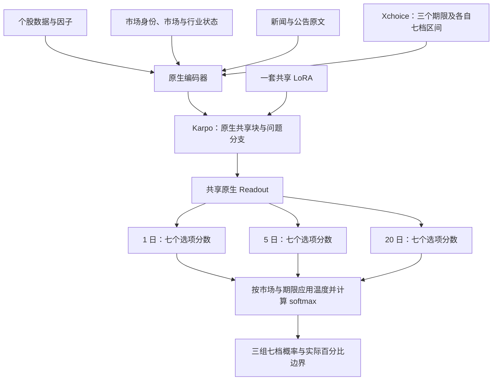
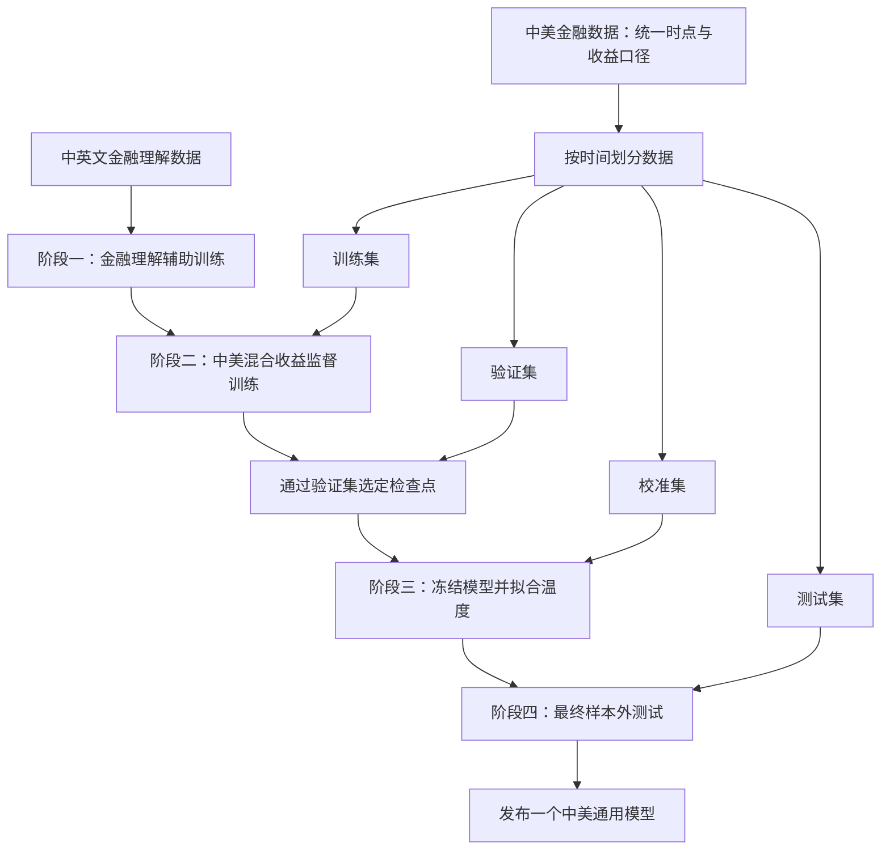

# Kurumi 后训练路径规划与模型架构报告

- **版本**：1.0
- **日期**：2026-11-18（Asia/Shanghai）
- **状态**：技术路线定稿，作为数据集准备、工程实现、实验与发布的行动契约
- **项目**：[sjyinzju/Kurumi](https://github.com/sjyinzju/Kurumi)
- **建议仓库位置**：`docs/kurumi_post_training_plan.md`

## 1. 目标与执行范围

Kurumi 在 `MachinePulseAI/karpo-decision-31B` 上进行金融后训练，形成**一个同时服务 A 股和美股的决策模型**。模型读取个股数据、金融因子、市场与行业状态，以及自然语言新闻和公告，输出目标股票未来 **1、5、20 个交易日的七档收益概率分布**。

课程研究检验：在相同结构化输入和统一完整信息使用环境下，收益监督训练时加入新闻、公告及两者组合，对预测准确率与概率质量的影响。最终应用模型采用新闻与公告齐全的 GNA 配置；其他训练版本用于研究对照。

**实施顺序为：本报告确定模型与训练需求 → 制定数据集契约 → 准备数据 → 实现训练 → 完成研究与发布。** 数据字段和数据来源由模型需求导出，下一份数据集契约具体规定原始字段、因子公式、来源映射、样本范围与时间边界。本报告替代初始化阶段对预测期限、分档和训练路线的暂定表述。

### 1.1 固定方案

| 项目 | 执行约定 |
|---|---|
| 基座 | `MachinePulseAI/karpo-decision-31B`，保留原生决策结构 |
| 最终模型 | 一个中美通用模型，统一加载、统一预测接口 |
| 预测任务 | 1／5／20 个目标市场交易日的收益区间概率 |
| 决策空间 | 每个期限七档，各自归一化 |
| 收益尺度 | 过去 60 个交易日的日对数收益样本标准差，乘以 $\sqrt h$ |
| 分档参数 | $\pm0.5$、$\pm1.5$ 个参考尺度，单独保留零收益档 |
| 参数更新 | 冻结原始骨干；训练共享 LoRA 和原生 Readout |
| 领域适应 | 中英文金融理解辅助训练 |
| 收益训练 | A 股与美股按 1∶1 混合采样，三个期限等权 |
| 监督目标 | CE＋0.5 Brier＋0.5 归一化 RPS |
| 校准 | 独立校准集拟合六个“市场×期限”温度 |
| 主研究组 | G0、GN、GA、GNA |
| 发布版本 | GNA 中按验证集 NLL 选定的一个检查点 |

本路线不设置强化学习阶段，不增加极端风险、强烈利好或“均匀分布”选项。市场专用骨干、额外收益回归头、独立波动率预测网络、模型集成、困难样本挖掘与非对称过采样不纳入主流程。

## 2. 预测任务与 Xchoice

### 2.1 时点、期限与收益

- 样本单位：**股票 × 预测截止时点**。
- 预测截止时点：目标市场当地交易日的 **23:59:59**；同时保存 UTC 时点。
- 中国市场使用 `Asia/Shanghai`，美国市场使用 `America/New_York`。
- 输入材料以真实可得时间不晚于预测截止时点为准。
- 预测期限按目标股票所属市场的交易日历计算。
- 收益以**本币计价、统一复权口径的当日收盘至未来目标日收盘收益**定义。

记 $A_{i,t}$ 为股票 $i$ 的复权收盘价，$t+h$ 表示本市场第 $h$ 个后续交易日：

$$
R_{i,t,h}=\frac{A_{i,t+h}}{A_{i,t}}-1,
\qquad h\in\{1,5,20\}.
$$

复权、停牌、退市及价格缺失的具体数据规则写入数据集契约，并生成标签有效性标记；缺失价格不直接转换为零收益。

### 2.2 历史尺度与标准化收益 Z

用过去 60 个交易日的日对数收益计算样本标准差：

$$
g_{i,t}=\log\frac{A_{i,t}}{A_{i,t-1}},
$$

$$
\hat{\sigma}_{i,t,60}
=
\operatorname{Std}_{\mathrm{sample}}
\left(g_{i,t-59},\ldots,g_{i,t}\right).
$$

标准差采用样本定义，分母为 $60-1$。未来 $h$ 日的参考尺度固定为：

$$
s_{i,t,h}=\hat{\sigma}_{i,t,60}\sqrt h.
$$

有效样本须具备过去 60 个交易日的有效日对数收益，且历史标准差为正；不满足者由数据管线标记无效。

标签侧的标准化收益定义为：

$$
\boxed{
Z_{i,t,h}
=
\frac{\log(1+R_{i,t,h})}
{\hat{\sigma}_{i,t,60}\sqrt h}
}
$$

**Z 表示未来收益相当于多少个历史参考波动尺度。** 分子不减历史平均收益，因此 Z 的正负号与真实收益的正负号一致。历史窗口、尺度算法和切点在两个市场、全部股票、三个期限与全部文本实验组中一致。

真实未来 R 和 Z 仅用于生成监督标签。模型输入只含截至预测时点已知的信息及由历史尺度生成的选项边界。模型直接学习各档概率，不通过正态分布公式计算概率。

### 2.3 七档定义

| 档位 | Z 的范围 | 选项名称 |
|---|---|---|
| 1 | $Z<-1.5$ | 较大下跌 |
| 2 | $-1.5\le Z<-0.5$ | 中等下跌 |
| 3 | $-0.5\le Z<0$ | 小幅下跌 |
| 4 | $Z=0$ | 零收益 |
| 5 | $0<Z\le0.5$ | 小幅上涨 |
| 6 | $0.5<Z\le1.5$ | 中等上涨 |
| 7 | $Z>1.5$ | 较大上涨 |

七档直接作为训练目标和展示结果，不设置额外的五档或三档合并层。选项始终按收益从低到高排列。表中使用 1—7 编号，训练张量使用 0—6 类别索引，两者通过固定映射对应。

切点 c 对应的具体收益率边界为：

$$
b_{i,t,h}(c)=\exp(c\,s_{i,t,h})-1.
$$

系统根据每个样本的历史尺度，生成各期限的精确百分比边界并写入 Xchoice。界面展示允许舍入，标签计算使用保存的精确边界。

### 2.4 原生问题定义与输出

每个收益样本固定携带三个问题，顺序为：

1. `return_1d`；
2. `return_5d`；
3. `return_20d`。

每题均有七个互斥、穷尽的选项。三个问题分别归一化：

$$
p_{\theta,i,h,k}
=
P_\theta\!\left(
R_{i,t,h}\in B_{i,t,h,k}
\mid X^{stock}_{i,t},X^{market}_{i,t},X^{text}_{i,t}
\right),
$$

$$
\sum_{k=1}^{7}p_{\theta,i,h,k}=1
\quad\text{对每个 }h\text{分别成立}.
$$

输出包括股票、市场、预测时点、期限、七个具体收益区间及对应概率。三个期限共输出 21 个概率值；它们是三个期限的边际收益分布。

## 3. Xstate 与市场状态

### 3.1 输入组成

| 输入块 | 内容要求 | 实验角色 |
|---|---|---|
| 个股状态 | 历史量价、财务信息、已计算的金融因子、必要的交易状态 | 四组共同输入 |
| 市场状态 | 市场身份、基准趋势、历史波动、上涨广度、成交活跃度 | 四组共同输入 |
| 行业与相对状态 | 行业趋势与波动、行业广度、个股相对行业和市场表现 | 四组共同输入 |
| 文本 | 截止时点之前可得的新闻、公告原文及必要来源信息 | 按 G0／GN／GA／GNA 切换 |
| 时间与质量信息 | 可得时间、单位、回看窗口、缺失及覆盖标记 | 由统一输入管线提供 |

行业与相对状态在实现中归入 `Xmarket` 或 `Xstock`，维持对外的三类输入表达。

市场与行业指标先由数据管线计算，再加入共享上下文。按“市场×时点”和“行业×时点”复用状态快照，不把全市场所有股票原始行情重复装入每个样本。市场信息引导股票预测的思路参考 [MASTER][R8]。

### 3.2 输入组织规则

1. 结构化数据和因子使用稳定字段名、单位及回看窗口。
2. 新闻与公告保留自然语言内容，使用统一的去重、排序、截断和来源标记规则。
3. 所有文本组保留完全相同的结构化内容；文本不能挤掉结构化字段。
4. 无对应文本的样本保留，用统一缺失标记表示。
5. 财务版本、行业归属与股票池按预测时点构造。
6. 跨市场关联使用真实可得时间与 UTC 时点。
7. 由结构化数字机械生成的描述属于共同输入，不计为新闻或公告增量。

后续数据集契约确定具体字段、因子公式、序列长度和文本预算；这些决定落实上述信息需求，不改变模型架构。

## 4. 模型架构与工程接入

### 4.1 推理架构



**一个共享 Readout 在三个问题位置分别读出分数。** 三个期限和两个市场共享骨干、LoRA 与 Readout。原生 [Readout][S4] 已支持按问题取出对应数量的选项分数。

### 4.2 参数更新范围

| 模块 | 执行方式 |
|---|---|
| 已有骨干权重 | 加载 Karpo 决策检查点，冻结原始参数 |
| 注意力线性投影 | 在实际存在的 q／k／v／o 投影上挂载 LoRA |
| MLP 线性投影 | 在 gate／up／down 投影上挂载 LoRA |
| 原生 Readout | 保留已有初始化，参与更新 |
| Tokenizer 与输入嵌入 | 沿用现有定义 |
| 注意力布局、分支、位置与读出标记 | 保留原生机制 |
| 原生 logits 后处理 | 保持一致，包括 soft-cap |
| 视觉部分 | 本任务采用数值与文本输入，视觉部分冻结且不启用 |
| LoRA dropout | 固定为 0 |

LoRA 的更新形式为：

$$
W_{\mathrm{effective}}
=
W_0+\frac{\alpha}{r}BA.
$$

训练只更新低秩增量及原生 Readout，原始 $W_0$ 保持冻结。方法依据见 [LoRA 原论文][R2]。

### 4.3 固定的训练接入方式

训练调用链为：

```text
Encoder.plan → pack → Packed → Readout → 每题七档损失 → backward
```

工程实现遵守以下约定：

1. 加载已有 Karpo 检查点中的 backbone、Readout、processor 和 decision config。
2. 冻结原始骨干后挂载 LoRA，并用同一骨干对象构造原生 Packed 前向。
3. 使用原生编码器生成问题布局、选项代码和读出位置。
4. 每个问题只对其七个选项计算概率与损失；监督标签是类别索引。
5. 冻结通过参数的 `requires_grad` 控制，训练前向保留计算图。
6. 训练、验证、校准、测试与部署保持三个问题及选项顺序一致。接口只返回一个期限时，内部仍执行固定的三个问题。
7. LoRA 与 Readout 采用不同优化器参数组，Readout 使用较小学习率。
8. 收益训练从原生 Readout 的未温度缩放 logits 计算损失。

原生 `Decider.logits()` 使用 `inference_mode`，不作为训练入口；原生梯度重计算设置与 dropout＝0 保持一致。工程依据见 [Decider][S1]、[问题布局][S2]、[Packed 前向][S3]和 [Readout][S4]。

### 4.4 环境与运行配置

训练使用 X-Lab H100，采用 BF16 骨干计算；概率、读出与损失的关键数值计算使用 FP32。保留原生激活重计算，使用梯度累积形成有效批次。

代码、原生依赖、模型 revision、CUDA／PyTorch 环境和实际 LoRA 挂载清单写入运行记录。已核读的原生代码基线为：

`6600011eb5cf46232d056ec0717dc726146d29de`。

开发阶段使用统一开发数据与验证规则，确定 LoRA 秩、学习率、有效批量、文本长度预算和训练步数配置。LoRA 参数结构、挂载范围与输入布局在正式共同金融理解训练前锁定；全部执行配置在主实验前锁定并共同复用。固定项包括更新范围、dropout、收益任务、损失系数、市场权重、期限权重及模型选择指标。

## 5. 后训练流程

### 5.1 总流程



### 5.2 阶段一：共同金融理解辅助训练

以原生“金融材料＋问题＋候选答案”训练下列能力：

| 能力 | 训练内容 |
|---|---|
| 口径理解 | 金额单位、币种、百分比与百分点、报告期、累计值与单季值 |
| 数值推理 | 同比、环比、利润率、负债率与多步财务计算 |
| 证据对齐 | 财报表格与文本中的事实对应、支持关系和事实冲突 |
| 事件理解 | 事件主体、否定与条件、拟实施／获批准／已执行等状态 |
| 信息相关性 | 公司实体对应、材料相关性和信息发布时间 |

正确答案来自既有标注、可执行计算和核验结果；干扰项来自单位、时期、分母或符号等明确错误。候选答案保持一致的呈现格式并调整正确选项位置。同一文档拆出的问答按文档分组管理。

本阶段使用交叉熵，更新同一套 LoRA 与 Readout，完成后保存**一份共同金融初始化检查点**。四个收益训练组全部从该检查点出发。金融理解辅助训练采用原生决策目标，不设置纯文本因果语言建模阶段。

数值与文本表格任务主要参考 [FinQA][R3]、[TAT-QA][R4]；中文金融任务参考 [BBT-CFLEB][R5]；领域任务组织参考 [Open-FinLLMs][R6]。

### 5.3 阶段二：中美混合收益监督训练

A 股与美股在同一个收益训练阶段中共同使用。**每个有效批次的市场权重为 50%／50%。** 微批次通过梯度累积汇总，两个市场共同更新一套 LoRA、Readout 与优化器状态。

每个样本同时预测三个期限。三个期限等权；标签有效性掩码排除缺失监督，并按有效任务归一化。四个文本组使用相同的样本清单和掩码。

阶段先后是“金融理解→收益预测”；A 股与美股在收益阶段内混合，不进行按市场依次完整训练。

#### 损失定义

数学公式中的类别编号 $y$ 使用 1—7，$p_k$ 为当前期限的七档概率。

交叉熵：

$$
L_{\mathrm{CE}}=-\log p_y.
$$

Brier：

$$
L_{\mathrm{Brier}}
=
\sum_{k=1}^{7}
\left(p_k-\mathbf 1[y=k]\right)^2.
$$

归一化 RPS：

$$
L_{\mathrm{RPS}}
=
\frac16\sum_{k=1}^{6}
\left(
\sum_{j=1}^{k}p_j-\mathbf 1[y\le k]
\right)^2.
$$

每个期限固定使用：

$$
\boxed{
L_h=L_{\mathrm{CE},h}
+0.5L_{\mathrm{Brier},h}
+0.5L_{\mathrm{RPS},h}
}
$$

完整标签样本按期限等权：

$$
L_i=\frac13\left(L_{i,1}+L_{i,5}+L_{i,20}\right).
$$

批次按市场等权：

$$
\boxed{
L_{\mathrm{batch}}
=
\frac12\overline L_{\mathrm A}
+
\frac12\overline L_{\mathrm{US}}.
}
$$

CE 负责真实档位的概率学习，Brier 约束整组概率误差，RPS 利用收益档位顺序。概率评分方法参考 [Gneiting 与 Raftery][R9]。

正则化采用权重衰减、梯度裁剪与验证集选点。市场平衡之外，不对未来涨跌类别进行非对称重采样，不额外叠加时间衰减和困难样本挖掘。

### 5.4 验证与检查点选择

验证集使用与主评估一致的完整输入：结构化数据、市场状态、新闻和公告。

检查点选择主指标为六个“市场×期限”单元的等权平均 NLL：

$$
S_{\mathrm{val}}
=
\frac16
\sum_{m\in\{\mathrm A,\mathrm{US}\}}
\sum_{h\in\{1,5,20\}}
\operatorname{NLL}_{m,h}.
$$

选择规则为最小 $S_{\mathrm{val}}$；同分时选择较早的检查点。同时记录 Brier、RPS 和七档准确率。模型选择使用未校准输出，正式温度拟合在下一阶段进行。

### 5.5 阶段三：独立温度校准

固定模型参数，在独立校准集上最小化 NLL。用 $\tau_{m,h}$ 参数化正温度：

$$
T_{m,h}=\exp(\tau_{m,h}),
$$

$$
p^{\mathrm{cal}}_{m,h,k}
=
\operatorname{softmax}_k\left(z_{m,h,k}/T_{m,h}\right).
$$

每个训练检查点保存六个温度：

- A 股：1 日、5 日、20 日；
- 美股：1 日、5 日、20 日。

六个温度属于同一个模型的配置。Kurumi 校准模块按 `market_id × horizon` 查表，在原生 logits 后执行一次温度缩放。该配置与原生按问题类型保存的温度设置分开管理，避免重复校准。

校准集使用完整输入。保存原始与校准后概率；七档最大概率选项的排序不因单一正温度改变。方法参考 [温度校准论文][R10]。

### 5.6 阶段四：测试与发布

测试集只承担最终评价。报告按市场、期限和文本训练组展开，主指标为 NLL、Brier、RPS、七档准确率及校准情况，并给出等市场、等期限汇总。

最终应用使用 GNA。在 GNA 的重复实验中，根据验证集 $S_{\mathrm{val}}$ 选出一个检查点作为发布版本；种子同分按预先固定顺序选择。研究报告同时保留全部重复结果。

发布一个统一模型包，包含模型权重、原生 Readout、输入组织规则、七档定义、尺度计算规则和六个温度。训练检查点保留 LoRA 与精确基座引用；发布加载器统一恢复全部组件。代码保存在 GitHub，模型产物保存在 Hugging Face。

## 6. 文本实验与公平比较

### 6.1 四个训练组

| 训练组 | 收益监督训练时的输入 |
|---|---|
| G0 | 结构化数据＋市场与行业状态 |
| GN | 共同输入＋新闻 |
| GA | 共同输入＋公告 |
| GNA | 共同输入＋新闻＋公告 |

G0 表示收益监督阶段不输入新闻与公告。四组共享金融理解辅助训练，因此该定义不涉及基座或共同初始化此前是否接触过金融文本。

### 6.2 主评估与补充诊断

**主评估：四个训练组都使用同一份完整推理输入。** 因此研究结论对应“统一完整信息使用环境下，文本后训练对预测效果的影响”。

补充诊断只对 G0、GNA 增加无文本推理评价，与已有完整输入评价组成 2×2 对照。诊断使用未校准概率，不增加训练任务或独立温度配置。

| 模型 | 无文本推理 | 完整文本推理 |
|---|---|---|
| G0 | 补充诊断 | 主评估 |
| GNA | 补充诊断 | 主评估 |

GN、GA 按主评估执行，不扩展全组合矩阵。

### 6.3 训练重复与预算

主实验使用固定随机种子 **17、29、43**。每个种子运行四组收益训练，共 **12 次收益监督训练**；共同金融理解辅助训练只执行一次。

每个种子内，四组共享：

- 同一金融初始化检查点；
- 股票样本与标签清单；
- 市场混合比例及采样顺序；
- 结构化内容与文本选择规则；
- 有效批量、最大更新步数及验证频率；
- LoRA 范围、损失、优化器设置和检查点选择规则。

记录实际 token 数、样本曝光次数与 GPU 时间。不同组因文本长度产生的计算差异如实记录，不通过增加无文本组样本曝光次数凑齐 token 数。

主报告给出三个种子的均值与标准差，并进行保留同日股票关系的配对时间块比较。重复训练用于估计训练随机性，最终模型不做多检查点集成。

## 7. 时间切分与信息管理

| 数据分段 | 用途 |
|---|---|
| 训练集 | 金融理解与收益监督的参数学习、训练侧预处理拟合 |
| 验证集 | 开发配置与检查点选择 |
| 校准集 | 六个温度的拟合 |
| 测试集 | 最终样本外评价 |

执行规则如下：

1. 四段按真实时间顺序排列，两个市场协调统一时间边界。
2. 上一阶段使用的收益标签，在下一阶段开始前必须已经实现。按实际标签终点处理跨界监督。
3. 金融辅助训练材料在训练截止时点前已公开；辅助验证材料按文档独立分组，不使用校准／测试期材料。同一文档拆出的问答保持在同一分组内。
4. 特征筛选、需要学习的预处理参数和训练设置只使用训练／开发分段。
5. 测试样本可以读取其预测时点之前已经发生的历史数据，以计算滚动指标和尺度。
6. 四个文本组使用相同的样本时间、标签及有效性标记。
7. 文本选择、清洗与摘要不读取未来收益或事后标签解释。
8. 股票池与行业归属保持历史版本；跨市场连接保留真实可得时点。

运行元数据登记基座 checkpoint、原生代码 revision、公开日期和公开训练数据说明；未披露的信息如实登记。基座历史记忆问题单独写入研究说明，不新增训练分支。研究结论限定为所登记基座和本报告后训练流程下的样本外比较。

## 8. 模块分工与交付物

继续在现有 `src/kurumi`、`configs`、`docs` 等目录内实现，各职责复用已有工具和数据访问能力。

| 模块职责 | 应交付内容 |
|---|---|
| 任务与标签 | 统一期限、尺度、七档边界、选项映射与标签转换 |
| 输入与批次 | Xstate 组织、文本组开关、中美平衡采样、有效性掩码 |
| Karpo 接入 | 原生加载、LoRA 挂载、共享 Readout、训练前向与推理入口 |
| 训练 | 金融辅助阶段、收益监督阶段、参数组、日志与检查点 |
| 评价与校准 | 六单元评价、温度拟合、原始和校准预测保存 |
| 发布 | 统一加载器、模型卡、配置、版本记录与使用示例 |

训练运行至少保存：

- 数据集版本、样本清单与时间切分；
- 基座及代码版本、环境和配置；
- 文本组、随机种子、采样与训练预算；
- LoRA、更新后的 Readout、优化器与调度器恢复状态、全局步数、随机数状态与采样进度；
- 验证选点记录、测试预测、校准参数和指标；
- 输入模板、任务定义、精确边界算法与选项映射。

大型原始数据、模型权重和运行缓存通过配置引用；Git 保存代码、契约、配置模板与必要的汇总记录。原始数据保持只读，衍生结果单独保存。

## 9. 实施顺序与完成标准

| 阶段 | 行动 | 完成标准 |
|---|---|---|
| 1. 数据集契约 | 根据本报告制定字段、因子、来源映射、时间与样本规则 | 文档明确 Xstate、Xchoice、Y 和四段时间切分 |
| 2. 原生训练接入 | 锁定环境，加载 Karpo，挂载 LoRA，接通损失与保存 | LoRA 和 Readout 得到有效梯度；原始冻结权重保持不变 |
| 3. 数据构建 | 完成金融辅助数据和中美收益数据，统一输入版本 | 时间、单位、选项、标签及文本开关一致 |
| 4. 训练配置锁定 | 在共同开发数据与验证流程中确定执行配置 | LoRA 参数结构、输入布局、配置、预算和选择规则写入仓库 |
| 5. 共同领域适应 | 完成金融理解训练并保存共同初始化 | 中英文辅助任务得到独立验证结果，检查点可加载，参数结构保持锁定 |
| 6. 主实验 | 完成四组、三个种子的收益监督训练 | 12 份运行记录、选定检查点及验证结果齐全 |
| 7. 校准与测试 | 拟合温度，完成主评估及各随机种子下 G0、GNA 的无文本诊断 | 原始与校准结果、分市场分期限指标和研究对照齐全 |
| 8. 发布 | 导出验证选定的 GNA 模型并编写模型卡 | 统一接口可加载，对相同输入重现保存的概率 |

工程验收集中验证：

- 三个问题分别产生七档归一化概率；
- LoRA 与原生 Readout 能被监督损失更新；
- 冻结骨干保持不变；
- 标签不进入输入；
- 训练与推理保留相同原生布局、选项顺序和 logits 处理；
- 保存并重新加载后，在相同精度和固定输入下保持数值一致；
- 六个温度被正确选择且只应用一次。

本报告固定技术路线和研究口径。实施中的学习率、批量与步数按开发流程确定并记录；模型结构、任务定义或研究口径变更时，更新本报告版本和相关配置后重新标记受影响实验。

## 10. 参考资料与具体采用部分

以下资料提供方法和工程依据。项目选择以本报告正文为准，参考项目中的其他任务与训练阶段不自动加入 Kurumi。

| 编号 | 资料 | 本项目采用的部分 |
|---|---|---|
| R1 | [Karpo 模型卡][R1]与[官方代码][S0] | 原生 state／questions 接口、问题布局、共享读出及检查点 |
| R2 | [LoRA][R2] | 冻结大规模权重、训练低秩参数增量 |
| R3 | [FinQA 论文][R3]与[代码／数据](https://github.com/czyssrs/FinQA) | 财报数值推理、推理程序与可核验辅助标签 |
| R4 | [TAT-QA 论文][R4]与[代码／数据](https://github.com/NExTplusplus/TAT-QA) | 金融文本与表格联合理解 |
| R5 | [BBT-CFLEB／FinCUGE 仓库][R5] | 中文金融任务组织与材料 |
| R6 | [Open-FinLLMs][R6] | 金融领域任务组织与领域适应思路 |
| R7 | [FinGPT-Forecaster][R7]、[Newsflow 收益预测][R11] | 新闻、行情、财务信息的组织及结果监督；收益标签与事后解释保留在目标侧 |
| R8 | [MASTER][R8] | 市场状态辅助股票预测的设计思路 |
| R9 | [Strictly Proper Scoring Rules, Prediction, and Estimation][R9] | 概率评分与分布学习 |
| R10 | [On Calibration of Modern Neural Networks][R10] | 独立温度校准与概率评价 |

### 原生源码定位

- [S1：Decider 推理接口][S1]。
- [S2：共享状态与问题分支][S2]。
- [S3：Packed 前向与重计算][S3]。
- [S4：Readout 与每题选项分数][S4]。
- [S5：检查点加载与保存][S5]。
- [S6：原生温度配置][S6]。
- [S7：Gemma 注意力与投影调用][S7]、[S8：MLP 投影调用][S8]。

[R1]: https://huggingface.co/MachinePulseAI/karpo-decision-31B
[R2]: https://arxiv.org/abs/2106.09685
[R3]: https://aclanthology.org/2021.emnlp-main.300/
[R4]: https://aclanthology.org/2021.acl-long.254/
[R5]: https://github.com/supersymmetry-technologies/BBT-FinCUGE-Applications
[R6]: https://arxiv.org/html/2408.11878v3
[R7]: https://github.com/AI4Finance-Foundation/FinGPT/tree/master/fingpt/FinGPT_Forecaster
[R8]: https://github.com/SJTU-DMTai/MASTER
[R9]: https://sites.stat.washington.edu/raftery/Research/PDF/Gneiting2007jasa.pdf
[R10]: https://proceedings.mlr.press/v70/guo17a.html
[R11]: https://arxiv.org/abs/2407.18103
[S0]: https://github.com/machinepulse-ai/karpo-decision/tree/6600011eb5cf46232d056ec0717dc726146d29de
[S1]: https://github.com/machinepulse-ai/karpo-decision/blob/6600011eb5cf46232d056ec0717dc726146d29de/src/karpo_decision/decider.py
[S2]: https://github.com/machinepulse-ai/karpo-decision/blob/6600011eb5cf46232d056ec0717dc726146d29de/src/karpo_decision/blocks.py
[S3]: https://github.com/machinepulse-ai/karpo-decision/blob/6600011eb5cf46232d056ec0717dc726146d29de/src/karpo_decision/model/packed.py
[S4]: https://github.com/machinepulse-ai/karpo-decision/blob/6600011eb5cf46232d056ec0717dc726146d29de/src/karpo_decision/model/readout.py
[S5]: https://github.com/machinepulse-ai/karpo-decision/blob/6600011eb5cf46232d056ec0717dc726146d29de/src/karpo_decision/checkpoint.py
[S6]: https://github.com/machinepulse-ai/karpo-decision/blob/6600011eb5cf46232d056ec0717dc726146d29de/src/karpo_decision/config.py
[S7]: https://github.com/machinepulse-ai/karpo-decision/blob/6600011eb5cf46232d056ec0717dc726146d29de/src/karpo_decision/families/gemma/packed.py
[S8]: https://github.com/machinepulse-ai/karpo-decision/blob/6600011eb5cf46232d056ec0717dc726146d29de/src/karpo_decision/families/gemma/fused.py

